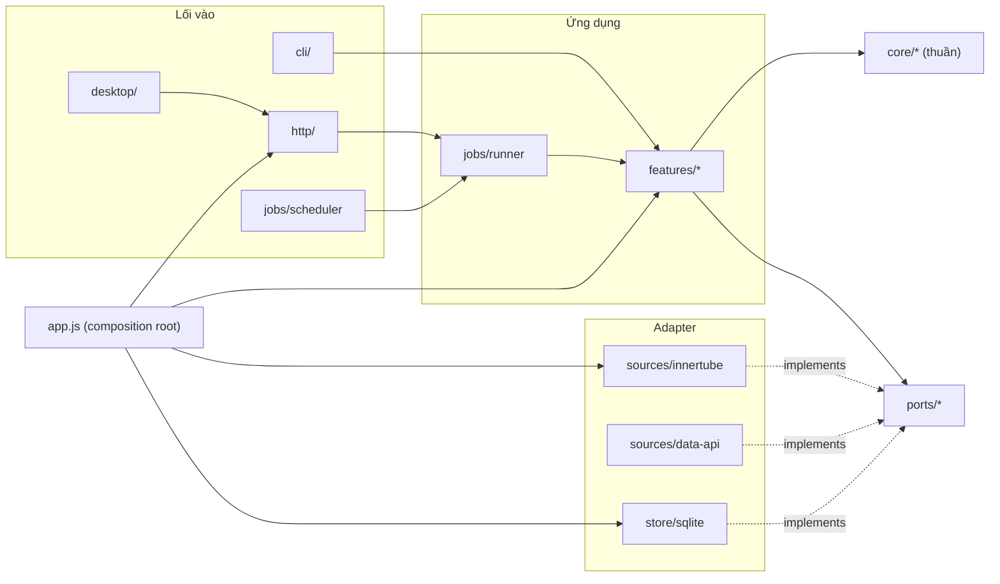

# Kiến trúc — YouTube Research

> Mục đích: một chỗ duy nhất trả lời "code mới đặt ở đâu, được gọi cái gì, không được gọi cái gì". Đọc trước khi thêm tính năng. Sản phẩm: [youtube-research-prd.md](youtube-research-prd.md).
> Cập nhật: 2026-11-09 · Áp dụng từ giai đoạn 0 trong [kế hoạch tái cấu trúc](plans/2026-11-09-architecture-refactor.md).

---

## 1. Hiện trạng (v0) và nợ kỹ thuật

| # | Nợ | Ở đâu (v0) | Hậu quả khi nâng cấp | Trạng thái |
|---|---|---|---|---|
| D1 | Một file "services" ôm mọi use case (519 dòng) | `src/services.js` | Thêm theo dõi kênh sẽ phình tiếp; khó test riêng | Đã xử lý (giai đoạn 0): `src/features/*` |
| D2 | Kết quả lưu thành JSON không có phiên bản | bảng `records.data` | Dữ liệu cũ thiếu trường mới (VPH, outlierScore) → đang vá ở giao diện (`components.js` tự tính VPH) | Đã xử lý: `schema_version` + `store/upgrades` |
| D3 | Không có migration; schema tạo bằng `CREATE IF NOT EXISTS` | `src/db.js` | Không đổi cột được an toàn; desktop của khách không nâng cấp được DB | Đã xử lý: migration đánh số + backup |
| D4 | Job chỉ nằm trong RAM | `src/jobs.js` | Tắt app là mất tiến trình; không làm được lịch quét / theo dõi | Đã xử lý: `jobs` trong SQLite, huỷ, gián đoạn |
| D5 | Logic nghiệp vụ gọi thẳng scraper | `services.js` import `yt/*` | Không thay được nguồn dữ liệu (Data API), không test được bằng dữ liệu giả | Đã xử lý: port `YouTubeSource` |
| D6 | Định nghĩa chỉ số rải rác, tên dễ lẫn (`outlier` = view/sub, `outlierScore` = × kênh) | metrics, text, components, report, server CSV | Đổi công thức phải sửa 5 nơi; tooltip/CSV/digest lệch nhau | Đã xử lý: registry, `viewSub` |
| D7 | Route HTTP regex + không kiểm tra input | `src/server.js` | Lỗi khó đoán; API không ổn định cho frontend mới / extension | Đã xử lý: `src/http` + validate + `/api/v1` |
| D8 | Frontend ghép chuỗi HTML, gắn listener mỗi lần render, `components.js` 401 dòng | `public/` | Rò listener; khó viết lại sang Preact; không đa ngôn ngữ | Một phần: client, scope/unmount, component tách file; Preact ở v1.2 |
| D9 | Cấu hình rải rác (cổng, đường dẫn data, gl mặc định) | server, db, innertube | Desktop cần `dataDir` theo hệ điều hành, cổng ngẫu nhiên | Đã xử lý: `src/config.js` |
| D10 | Test chỉ có unit thuần, không có fixture phản hồi YouTube | `test/` | YouTube đổi định dạng → chỉ biết khi người dùng gặp lỗi | Đã xử lý: fixture + test hợp đồng + `npm run probe` |
| D11 | Không có `workspace_id` | mọi bảng người dùng | Lên SaaS phải viết lại toàn bộ truy vấn | Một phần: có cột `workspace_id`, chưa có đăng nhập |

---

## 2. Nguyên tắc

1. **Ports & adapters (hexagonal).** Lõi nghiệp vụ không biết YouTube trả JSON ra sao, không biết SQLite, không biết HTTP.
2. **Phụ thuộc chỉ đi vào trong**: `http/cli/desktop → features → core`; `features → ports`; `adapters → ports`. Không bao giờ ngược lại.
3. **Composition root duy nhất** (`src/app.js`) quyết định dùng adapter nào. Không file nào khác `new`/import adapter cụ thể.
4. **Dữ liệu có phiên bản.** Schema DB qua migration đánh số; mỗi record có `schema_version` và được nâng cấp khi đọc.
5. **Chỉ số định nghĩa một lần** trong registry; giao diện, CSV, Markdown, tooltip đọc từ đó.
6. **Không cần bước build cho backend.** JS + JSDoc + `tsc --checkJs` để bắt lỗi kiểu.
7. **Thêm tính năng = thêm file**, không sửa file chung ngoài chỗ đăng ký (route table, job registry, nav).

---

## 3. Cấu trúc thư mục đích

```
src/
  app.js                    # composition root: đọc config, tạo store/source/jobs, đăng ký features
  config.js                 # cổng, dataDir, logLevel, edition (dev|desktop|server) — từ env + mặc định theo OS
  core/                     # THUẦN: không I/O, không import ngoài core/
    types.js                # @typedef Video, Channel, Comment, Baseline, KeywordScore, RecordEnvelope…
    metrics/
      definitions.js        # REGISTRY chỉ số: id, nhãn VI/EN, công thức (chữ), đơn vị, phiên bản
      video.js              # vph, viewsPerDay, viewSub, age
      outlier.js            # channelBaseline, outlierScore
      channel.js            # channelStats
    analysis/               # titles.js, comments.js, durations.js, keyword-score.js, topic.js (lọc đúng chủ đề, bỏ dấu)
    tiktok/metrics.js       # videoMetrics (Hot score, tương tác, tuổi), attentionPerDay
    tracking/diff.js        # so snapshot: video mới, tốc độ, đổi tiêu đề/thumbnail (v1.1)
    report/                 # markdown.js, csv.js, tiktok.js (Markdown insight + comment TikTok)
  ports/                    # HỢP ĐỒNG (JSDoc interface + test hợp đồng dùng chung)
    youtube-source.js       # searchVideos, searchChannels, getChannel, getChannelVideos, getShorts,
                            # getVideo, getComments, suggest, capabilities()
    tiktok-source.js        # searchVideos, resolveVideo, getComments, capabilities(), close()
    store.js                # repos: cache, records, saved, settings, jobs, tracking, license
    job-queue.js            # enqueue, get, list, cancel, onProgress
    clock.js                # now() — để test lịch quét
  sources/
    innertube/              # client.js (rate limit, retry), parse.js, search.js, channel.js, comments.js, suggest.js
      fixtures/             # phản hồi YouTube ghi sẵn (đã lược) cho test
    data-api/               # (v1.2) YouTube Data API v3, BYOK, quota tracker
    tiktok/                 # index.js (createTikTokSource), browser.js (Chromium ẩn, đóng khi rảnh), search.js,
                            # http.js (retry, giới hạn song song), comments.js, parse.js, fixtures/
    fake/                   # nguồn giả trả fixture — dùng cho test features (tiktok.js cho TikTok)
  store/
    sqlite/
      db.js                 # mở DB, WAL, chạy migration, backup trước migration
      migrations/           # 001_init.sql, 002_jobs.sql, … (đánh số, không sửa file cũ)
      repos/                # cache.js, records.js, saved.js, settings.js, jobs.js, tracking.js
    upgrades/               # nâng cấp record theo kind: video_search.js (v1→v2 thêm vph…)
  jobs/
    runner.js               # job lưu DB, trạng thái, huỷ, idempotency, khôi phục khi khởi động
    scheduler.js            # (v1.1) tick 5 phút → enqueue job đến hạn
    registry.js             # kind → feature handler
  features/                 # USE CASE: một file một tính năng, nhận deps qua tham số
    video-search.js
    channel-search.js
    channel-analysis.js
    topic-research.js
    comments.js
    keyword-score.js
    keyword-ideas.js
    tracking.js             # (v1.1)
    tiktok/                 # search.js, comments.js, insight.js
  http/
    server.js               # node:http, static, error → JSON {error:{code,message}}
    router.js               # bảng route khai báo + validate
    validate.js             # schema nhỏ không phụ thuộc (hoặc zod nếu chấp nhận dependency)
    routes/                 # jobs.js, records.js, saved.js, settings.js, status.js, tracking.js
  license/                  # (v1.2) service.js, verify.js — chỉ dùng qua middleware
  cli/index.js
desktop/                    # (v1.2) Electron main, tray, notify, updater
web/                        # frontend (đổi tên từ public/)
  http/client.js            # MỌI fetch đi qua đây (không đặt tên web/api/: trùng tiền tố /api/ của server)
  components/               # video-table.js, video-grid.js, filters.js, score-card.js, charts.js…
  views/                    # một màn một file, export mount(root, params) → trả về unmount()
    tiktok/                 # search.js, insight.js, comments.js
  i18n/vi.js, en.js         # (v1.2)
test/
  core/  sources/  features/  http/  arch.test.js
```

Ánh xạ từ v0: `src/yt/*` → `sources/innertube/*` · `src/analysis/*` → `core/*` · `src/services.js` → `features/*` · `src/db.js` → `store/sqlite/*` · `src/jobs.js` → `jobs/runner.js` · `src/server.js` → `http/*` · `public/` → `web/`.

---

## 4. Các lớp và luật



| Lớp | Được import | Cấm import |
|---|---|---|
| `core/` | chỉ `core/` | mọi thứ khác, `node:*` có I/O (`fs`, `http`, `sqlite`) |
| `ports/` | `core/types.js` | adapter |
| `features/` | `core/`, `ports/` (kiểu) | `sources/*`, `store/*`, `http/*` |
| `sources/*`, `store/*` | `core/types.js`, `ports/` | `features/`, `http/` |
| `sources/tiktok/` | `core/`, `ports/` | `sources/innertube/`, `features/`, `store/`, `http/`, `jobs/` |
| `features/tiktok/` | `core/`, `ports/`, `features/shared.js` | `sources/`, `store/`, `http/`, use case YouTube |
| `http/`, `cli/`, `desktop/` | `features/` qua deps được tiêm, `jobs/` | adapter trực tiếp |
| `web/` | `web/` | không import gì từ `src/`; chỉ nói chuyện qua HTTP |

**Kiểm tra tự động**: `test/arch.test.js` đọc import của mọi file và fail nếu vi phạm bảng trên. Chạy trong `npm test`.

**Feature nhận phụ thuộc qua tham số**, không import adapter:

```js
// features/video-search.js
/** @param {{source: import('../ports/youtube-source.js').YouTubeSource,
 *           store: import('../ports/store.js').Store, clock: {now(): number}}} deps */
export function makeVideoSearch(deps) {
  return async function videoSearch(params, progress) { /* … */ };
}
```

---

## 5. Dữ liệu

### 5.1 Migration

- File `store/sqlite/migrations/NNN_ten.sql`, chạy theo thứ tự, ghi số vào `PRAGMA user_version`.
- **Không sửa migration đã phát hành.** Đổi gì cũng là file mới.
- Trước khi chạy migration mới: copy `research.db` → `backups/research-<version>-<ngày>.db` (giữ 5 bản).
- Migration 001 tái tạo đúng schema v0 để máy đang chạy nâng cấp liền mạch.

### 5.2 Bảng (đích)

| Bảng | Mục đích | Ghi chú |
|---|---|---|
| `channels`, `channel_videos`, `video_details` | cache nguồn | khoá tự nhiên = id YouTube; `fetched_at`; không cần `workspace_id` (dữ liệu công khai, dùng chung) |
| `records` | kết quả mỗi tác vụ | `workspace_id`, `kind`, `schema_version`, `params`, `data`, `job_id`, `created_at` |
| `saved` | đã lưu | `workspace_id`, PK (`workspace_id`, `kind`, `ref`) |
| `settings` | cài đặt | `workspace_id`, `key` |
| `jobs` | job nền | `id`, `workspace_id`, `kind`, `status`, `params`, `progress`, `idempotency_key UNIQUE`, `attempts`, `error`, `record_id`, `created_at`, `started_at`, `finished_at`, `cancel_requested` |
| `request_log` | quan sát | `endpoint`, `status`, `ms`, `at` (giữ 7 ngày) |
| `tracked_targets` (v1.1) | kênh/từ khoá theo dõi | `workspace_id`, `type`, `ref`, `interval_min`, `next_run_at`, `active` |
| `video_snapshots`, `channel_snapshots` (v1.1) | lịch sử | (`video_id`, `captured_at`) PK; `views`, `title`, `thumb_hash` |
| `alerts` (v1.1) | cảnh báo | UNIQUE(`target_id`, `video_id`, `type`) |
| `license` (v1.2) | kích hoạt | token đã ký, `instance_id`, `last_check_at`, `status` |

`workspace_id` mặc định `'local'`. Mọi repo nhận `workspaceId` làm tham số đầu tiên — khi lên SaaS chỉ việc truyền id thật.

### 5.3 Record có phiên bản

```js
/** @typedef {{kind: string, schemaVersion: number, data: any}} RecordEnvelope */
// store/upgrades/video_search.js
export const latest = 2;
export const steps = {
  1: (d) => ({ ...d, videos: d.videos.map(addVph) }),   // v1 → v2
};
```

- Repo `records.get()` luôn trả bản **mới nhất** (chạy các bước nâng cấp trong RAM; ghi lại khi lưu lần sau).
- Giao diện **không bao giờ** tự vá dữ liệu cũ.
- Mỗi lần đổi hình dạng `data` của một kind: tăng `latest`, thêm một bước, thêm test với record cũ mẫu.

---

## 6. Registry chỉ số

`core/metrics/definitions.js` là nguồn sự thật duy nhất:

```js
export const METRICS = {
  outlierScore: { label: { vi: 'Outlier (× kênh)', en: 'Outlier (× channel)' }, unit: 'x',
    formula: 'view ÷ trung vị view các video ≥ 7 ngày trong 30 video mới nhất của kênh; video < 7 ngày so VPH',
    version: 1 },
  viewSub:      { label: { vi: 'View/sub', en: 'Views/sub' }, unit: 'x', formula: 'view ÷ số sub kênh (bỏ kênh < 500 sub)', version: 1 },
  vph:          { label: { vi: 'VPH', en: 'VPH' }, unit: 'per_hour', formula: 'view ÷ số giờ kể từ lúc đăng', version: 1 },
  // …
};
```

- Đổi tên trường cho khỏi lẫn: `outlier` (v0, view/sub) → **`viewSub`**; `outlierScore` giữ nguyên. Đổi qua bước nâng cấp record, không đổi tay ở giao diện.
- Tooltip, tiêu đề cột CSV, chữ trong Markdown, i18n đều lấy từ registry.
- Đổi công thức → tăng `version` của chỉ số, ghi trong record (`metricsVersion`) để biết báo cáo cũ tính theo công thức nào.

---

## 7. Job nền

Trạng thái: `queued → running → (succeeded | failed | cancelled | interrupted)`.

- Job lưu ở bảng `jobs`; runner chạy trong cùng tiến trình (desktop). Port `job-queue` cho phép thay bằng pg-boss khi lên SaaS.
- **Idempotency**: `idempotency_key = hash(workspace, kind, params chuẩn hoá, slot thời gian)`; trùng key khi job cũ còn `queued/running` → trả job cũ.
- **Khởi động lại**: job `running` từ lần chạy trước → `interrupted`, giao diện có nút chạy lại.
- **Huỷ**: đặt `cancel_requested`; feature kiểm tra giữa các bước qua `ctx.signal`.
- **Ngân sách request**: mỗi kind có trần (vd video_search 300, research 600); vượt → dừng và báo.
- Chi tiết lỗi/thử lại: [jobs-and-scraping-L4.md](jobs-and-scraping-L4.md).

---

## 8. Nguồn dữ liệu (port `YouTubeSource`)

```js
/** @typedef {object} YouTubeSource
 * @property {(q: string, o: SearchOpts) => Promise<Video[]>} searchVideos
 * @property {(q: string, o: SearchOpts) => Promise<ChannelHit[]>} searchChannels
 * @property {(id: string, o?: {about?: boolean}) => Promise<Channel>} getChannel
 * @property {(id: string, o?: {max?: number}) => Promise<Video[]>} getChannelVideos
 * @property {(id: string, o?: {likes?: boolean}) => Promise<VideoDetail>} getVideo
 * @property {(id: string, o: CommentOpts) => Promise<{comments: Comment[], disabled: boolean}>} getComments
 * @property {(q: string, o: {gl?: string, hl?: string}) => Promise<string[]>} suggest
 * @property {() => {captionsFilter: boolean, ccFilter: boolean, quota?: {used: number, limit: number}}} capabilities
 */
```

- Kiểu trả về dùng chung (`core/types.js`). Adapter chịu trách nhiệm chuẩn hoá (số đếm, ngày, thời lượng).
- Tính năng nào cần khả năng adapter không có (vd Data API không có bộ lọc Captions trong search) → đọc `capabilities()` và ẩn phần đó, không `if (adapter === …)`.
- **Test hợp đồng** `test/sources/contract.js` chạy cùng một bộ kiểm tra cho mọi adapter (fake, innertube với fixture, data-api với fixture).
- **Probe sống** `npm run probe`: gọi thật 1 lần mỗi endpoint, so hình dạng với fixture; desktop chạy mỗi ngày, ghi `probe_runs`.

---

## 9. HTTP API

- Tiền tố `/api/v1/…` (giữ alias `/api/…` một phiên bản cho giao diện cũ).
- Route khai báo trong bảng, mỗi route có `schema` cho body/query; lỗi validate → `400 {error:{code:'invalid_input', field, message}}`.
- Lỗi chuẩn: `{ error: { code, message } }`; mã: `invalid_input`, `not_found`, `rate_limited`, `source_changed`, `license_required`, `internal`.
- Job: `POST /api/v1/jobs {kind, params}` → `{id}`; `GET /api/v1/jobs/:id`; `POST /api/v1/jobs/:id/cancel`. Không trả kết quả lớn qua job — lấy ở `/records/:id`.
- Chỉ nghe `127.0.0.1`. Khi lên SaaS thêm middleware auth gán `workspaceId` vào `ctx`.

---

## 10. Frontend

v1.0–1.1 (JS thuần, không build):
- `web/http/client.js` là nơi duy nhất gọi `fetch`.
- Mỗi view `export function mount(root, params)` **trả về `unmount()`**; mọi listener gắn qua helper `on(root, event, selector, fn)` để gỡ được.
- Component nhận dữ liệu + callback, trả HTML; không tự gọi API.
- Không chuỗi giao diện nào hard-code trong component mới: dùng `t('key')` (bước đệm cho i18n).

v1.2: chuyển sang **Preact + Vite** từng màn một (bắt đầu từ Chấm điểm từ khoá vì tách biệt nhất). Giữ API không đổi nên backend không bị ảnh hưởng.

---

## 11. Cấu hình & phiên bản đóng gói

`src/config.js` là nơi duy nhất đọc `process.env`:

| Khoá | dev | desktop | server (v2) |
|---|---|---|---|
| `dataDir` | `./data` | thư mục userData của Electron | `/var/lib/ytr` |
| `port` | 5178 | 0 (ngẫu nhiên) | 8080 |
| `host` | 127.0.0.1 | 127.0.0.1 | 0.0.0.0 sau reverse proxy |
| `edition` | dev | desktop | server |
| `license` | tắt | bật | tắt (dùng billing) |

---

## 12. Test

| Tầng | Cái gì | Công cụ |
|---|---|---|
| core | hàm thuần, công thức chỉ số | `node:test`, ≥ 80% dòng |
| sources | parser với fixture; hợp đồng chung | fixture JSON đã lược ≤ 50 KB/file |
| store | migration từ DB v0 mẫu; nâng cấp record cũ | SQLite trong RAM |
| features | use case với `sources/fake` + store RAM | không mạng |
| http | route + validate + mã lỗi | server thật cổng 0 |
| arch | luật import | `test/arch.test.js` |
| probe | YouTube thật | `npm run probe` (không chạy trong `npm test`) |

`npm test` = typecheck (`tsc --noEmit -p jsconfig.json`) + `node --test`.

---

## 13. Quyết định kiến trúc (ADR rút gọn)

| # | Quyết định | Lý do | Xem lại khi |
|---|---|---|---|
| A1 | JS + JSDoc, không TypeScript build | Giữ chạy trực tiếp bằng node, launcher/CLI đơn giản; vẫn có kiểm tra kiểu | Đội > 2 người hoặc frontend chuyển Vite (khi đó cân nhắc TS cho `web/`) |
| A2 | SQLite qua `node:sqlite`, không ORM | Không dependency native, đủ cho desktop | Lên SaaS: thêm adapter Postgres sau port `store` |
| A3 | Job trong tiến trình, lưu DB | Desktop một người dùng | SaaS: pg-boss sau port `job-queue` |
| A4 | Desktop trước SaaS | Mỗi khách cào bằng IP của mình, không chi phí proxy/server | Có 50 khách trả tiền |
| A5 | Nguồn dữ liệu là port | Rủi ro YouTube đổi định dạng + rủi ro điều khoản | — |
| A6 | Frontend JS thuần đến v1.1, Preact + Vite ở v1.2 | Không viết lại khi chưa cần; API có schema trước | — |
| A7 | Không dependency runtime bắt buộc cho backend. Ngoại lệ duy nhất: `playwright` trong optionalDependencies, chỉ cho tìm kiếm TikTok (TikTok ký request bằng JS của họ); import động; bản desktop sẽ thay bằng cửa sổ ẩn Electron | Cài/đóng gói đơn giản, ít lỗ hổng | Validation phức tạp → cân nhắc zod |

---

## 14. Checklist mỗi khi thêm tính năng

- [ ] Use case mới là **một file** trong `features/`, nhận deps qua tham số.
- [ ] Tính toán thuần đặt trong `core/` và có test.
- [ ] Cần dữ liệu YouTube mới → thêm method vào port + **mọi** adapter (hoặc khai báo trong `capabilities()`), thêm fixture.
- [ ] Đổi schema DB → migration mới; đổi hình dạng record → tăng `schema_version` + bước nâng cấp + test record cũ.
- [ ] Chỉ số mới/đổi công thức → registry (`definitions.js`), không viết nhãn/công thức ở nơi khác.
- [ ] Route mới có schema validate và mã lỗi chuẩn.
- [ ] View mới trả `unmount()` (listener trên phần tử sống lâu đi qua `scope()` trong `web/dom.js`), gọi API qua `web/http/client.js`.
- [ ] `npm test` xanh (gồm typecheck và arch test).
- [ ] Cập nhật PRD/L4 nếu đổi luồng; cập nhật skill nếu đổi CLI/digest.
