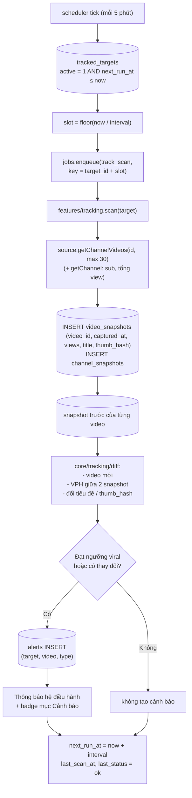
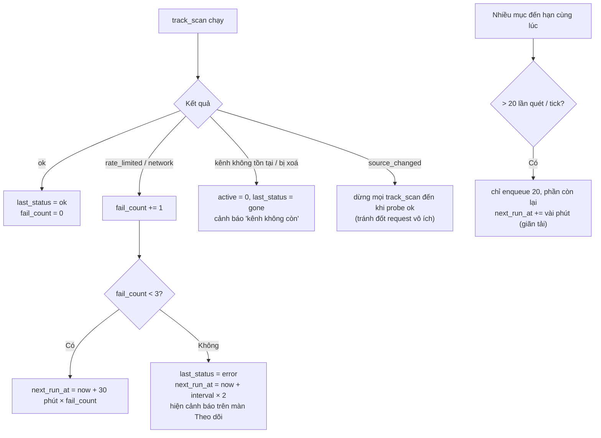
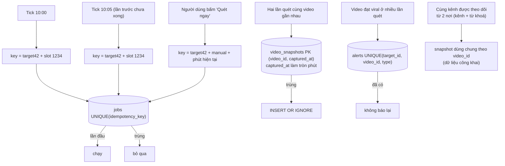
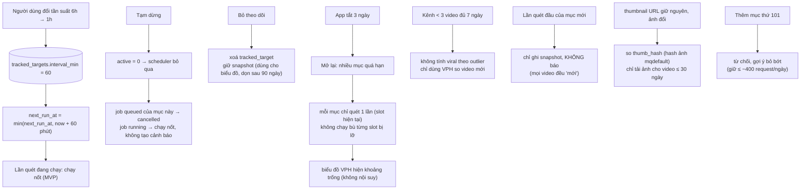

# L4 — Theo dõi kênh / từ khoá (v1.1)

Lý do cần L4: lập lịch nền, máy trạng thái lần quét, chống quét trùng và báo trùng, sửa/tạm dừng khi đang có lần quét.

Thành phần: `jobs/scheduler.js` (tick 5 phút khi app chạy), `jobs/runner.js`, `features/tracking.js`, `core/tracking/diff.js`, bảng `tracked_targets`, `video_snapshots`, `channel_snapshots`, `alerts`, `desktop/notify`.

Ngưỡng mặc định (Cài đặt): tần suất 6 giờ; viral = video ≤ 7 ngày tuổi có `outlierScore ≥ 5` hoặc VPH ≥ 5× VPH trung vị video mới của kênh; tối đa 100 mục theo dõi.

---

## Flow 1 — Happy Path

---

## Flow 2 — Error & Retry

---

## Flow 3 — Idempotency & Concurrency

---

## Flow 4 — Edge Cases

