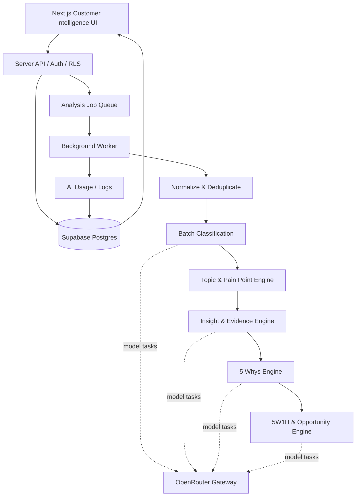

# PRODUCT REQUIREMENTS DOCUMENT (PRD)
# Customer Intelligence & Content Opportunity Engine

**Phiên bản:** 1.0  
**Trạng thái:** Draft for implementation  
**Ngôn ngữ sản phẩm:** Tiếng Việt (có thể mở rộng i18n)  
**Nền tảng nguồn:** TikTok, Facebook, YouTube và dữ liệu nhập thủ công  
**Định hướng công nghệ mặc định:** Next.js App Router, Supabase/Postgres (RLS), background worker, OpenRouter model gateway, Vitest. Các lựa chọn công nghệ có thể thay đổi mà không làm thay đổi nghiệp vụ.

---

## 1. Tóm tắt sản phẩm

Customer Intelligence là module thống nhất để chuyển dữ liệu video/comment trên các nền tảng social thành hiểu biết có bằng chứng về khách hàng, nguyên nhân gốc của pain point và cơ hội nội dung có thể triển khai.

Sản phẩm thay thế hai luồng phân tích rời nhau hiện tại — **Insight khách hàng** và **5W1H** — bằng một workflow có liên kết nguồn gốc:

**Source Data → Comment Intelligence → Topics & Pain Points → Evidence-backed Insight → 5 Whys → 5W1H Content Brief → Content Opportunities → Idea Board → Performance Feedback.**

5 Whys và 5W1H phục vụ hai mục tiêu khác nhau:

- **5 Whys:** đào sâu nguyên nhân và động cơ phía sau vấn đề khách hàng. Cho phép dừng trước Why 5 nếu dữ liệu không đủ; cho phép nhiều nhánh nguyên nhân.
- **5W1H:** biến insight đã được kiểm tra thành brief nội dung: Who, What, Why, When, Where, How.

Mọi Insight, Why node và Content Opportunity phải truy ngược được về comment/video nguồn. Sản phẩm phải phân biệt rõ **Observed fact**, **Inference**, **Hypothesis** và **Unverified**. AI không được biến suy đoán thành dữ kiện.

### 1.1 Tuyên bố giá trị

Người dùng không chỉ biết comment nào phổ biến; họ hiểu:

1. Khách hàng nào đang gặp vấn đề gì.
2. Bằng chứng nào cho thấy vấn đề đó có thật và phổ biến đến đâu.
3. Những nguyên nhân nào có thể đứng phía sau vấn đề, nguyên nhân nào đã được hỗ trợ bởi dữ liệu và nguyên nhân nào mới là giả thuyết.
4. Nên tạo nội dung nào, cho ai, với thông điệp/góc tiếp cận/CTA nào.
5. Cơ hội nào nên được ưu tiên và nội dung đã đăng có tạo kết quả hay không.

### 1.2 Nguyên tắc sản phẩm

- **Evidence first:** kết luận phải có nguồn hoặc phải ghi rõ là giả thuyết.
- **Traceability:** mọi insight/idea phải có thể mở tới comment gốc và video/post nguồn.
- **Human in the loop:** AI đề xuất; người dùng có quyền xác nhận, sửa, từ chối, gộp hoặc tách.
- **Code before AI:** dùng code cho thống kê, dedup, lọc, tính điểm và logic xác định; dùng AI cho phân loại ngữ nghĩa, tổng hợp và suy luận.
- **Incremental by default:** chỉ phân tích dữ liệu mới hoặc phần đã thay đổi.
- **No forced completion:** không ép AI tạo đủ 5 Why hoặc đủ 6 phần 5W1H khi thiếu dữ liệu.
- **One workflow, focused screens:** dữ liệu comment, insight, 5 Whys và content opportunity là các bước của cùng một quy trình, không phải những báo cáo độc lập.

---

## 2. Mục tiêu, chỉ số thành công và phạm vi

### 2.1 Mục tiêu

| ID | Mục tiêu | Kết quả mong đợi |
|---|---|---|
| G-01 | Hợp nhất Insight và 5W1H | Người dùng đi từ topic/comment đến content idea trong cùng một workspace |
| G-02 | Tăng khả năng kiểm chứng | Mỗi insight và opportunity hiển thị bằng chứng nguồn |
| G-03 | Đào sâu pain point | Tạo 5 Whys có nhánh, confidence, evidence và trạng thái xác minh |
| G-04 | Tạo brief dùng được | 5W1H và content angles sinh từ insight/root-cause đã chọn |
| G-05 | Giảm chi phí AI | Batch, cache, incremental processing, model routing và lazy execution |
| G-06 | Đóng vòng lặp | Liên kết idea với trạng thái sản xuất/đăng và số liệu hiệu quả |

### 2.2 North-star metric

**Evidence-backed Content Opportunities được người dùng chấp thuận và đưa vào sản xuất trên mỗi Analysis Run.**

Không dùng số lượng idea AI sinh ra làm north-star; nhiều idea nhưng không có bằng chứng hoặc không được sử dụng không phải thành công.

### 2.3 KPI sản phẩm

- Tỷ lệ Insight có ít nhất một evidence source hợp lệ.
- Tỷ lệ Content Opportunity có evidence link và root-cause link.
- Tỷ lệ AI classifications được người dùng xác nhận hoặc sửa.
- Tỷ lệ Opportunity được lưu/đưa vào Idea Board.
- Thời gian từ khi nhập dữ liệu đến khi có Opportunity đầu tiên.
- Chi phí AI trên 1.000 comments và trên một Opportunity được duyệt.
- Tỷ lệ cache hit và tỷ lệ chỉ xử lý incrementally.
- Tỷ lệ job lỗi, JSON validation failure và retry.
- Sau khi publish: views, watch time/retention, comments, saves, shares, clicks/leads — chỉ tính các chỉ số thực sự có dữ liệu.

### 2.4 In scope — MVP

1. Nguồn TikTok, Facebook, YouTube và manual import (chỉ dùng connector/API hợp lệ hoặc dữ liệu người dùng cung cấp).
2. Chuẩn hóa video/post/comment/reply.
3. Deduplication và comment classification đa nhãn.
4. Topic clustering, Pain Point và Insight discovery.
5. Evidence panel: comment gốc, nguồn, engagement và trạng thái support/contradiction.
6. 5 Whys có nhánh và bằng chứng theo từng Why.
7. 5W1H Content Brief.
8. Content Opportunity cards, scoring và Idea Board handoff.
9. OpenRouter orchestration, cost tracking, caching, incremental analysis.
10. Analysis history, rerun có chọn lọc và export Markdown/CSV/JSON.

### 2.5 Out of scope — MVP

- Tự động đăng nội dung lên mọi nền tảng.
- Tự động nhắn tin/lead outreach.
- Khẳng định sự thật pháp lý/di trú, y tế, tài chính hoặc các lĩnh vực có rủi ro cao chỉ dựa trên comment.
- Tự động kết luận danh tính, nhân khẩu học nhạy cảm của người bình luận.
- Tự động xem/nghe video nếu nguồn tích hợp không cung cấp media/transcript và hệ thống chưa có khả năng xử lý đó.
- Dùng Viral Content Analyst thay cho Customer Insight workflow.

---

## 3. Người dùng và use cases

### 3.1 Personas

**P1 — Content Strategist / Owner**  
Muốn biết khán giả đang lo gì, chủ đề nào có cơ hội tạo khách hàng và nên sản xuất nội dung gì tiếp theo.

**P2 — Researcher / Analyst**  
Muốn lọc comment, kiểm tra nhóm chủ đề, xác nhận bằng chứng, sửa nhãn và tìm mâu thuẫn.

**P3 — Content Producer**  
Cần nhận brief rõ ràng gồm audience, pain point, message, hook, format, CTA, source và fact-check notes.

### 3.2 Use cases trọng yếu

- UC-01: Phân tích một tập video/comment và xem tổng quan khách hàng.
- UC-02: Mở một topic, xem pain points, câu hỏi và comment nguồn.
- UC-03: Chọn một pain point và chạy 5 Whys.
- UC-04: Xác nhận/sửa một nhánh nguyên nhân; đánh dấu giả thuyết chưa kiểm chứng.
- UC-05: Tạo 5W1H brief từ một insight/root-cause đã chọn.
- UC-06: Sinh, chấm điểm, so sánh và lưu Content Opportunities.
- UC-07: Tạo idea khác từ cùng insight nhưng khác format/audience/angle.
- UC-08: Ghi nhận trạng thái sản xuất, link bài đã đăng và hiệu quả.
- UC-09: Rerun chỉ phần có thay đổi, theo dõi AI cost.

---

## 4. Ngôn ngữ dữ liệu và định nghĩa

Các khái niệm dưới đây phải được dùng nhất quán trong UI, DB và prompt.

| Entity | Định nghĩa | Ví dụ |
|---|---|---|
| Source Item | Video, post hoặc nội dung nguồn | TikTok video VID-01 |
| Comment | Bình luận/reply nguyên bản, bất biến sau khi ingest | CMT-001 |
| Topic | Chủ đề tổng quát gom nhiều vấn đề gần nhau | Processing Time |
| Pain Point | Vấn đề cụ thể khách hàng thể hiện | Không biết hồ sơ đang ở giai đoạn nào |
| Customer Segment | Nhóm có cùng bối cảnh/nhu cầu liên quan | Người đang chờ hồ sơ F4 |
| Insight | Nhận định có ý nghĩa về nhu cầu, rào cản hoặc hành vi; có bằng chứng và mức suy luận | Khách hàng cần hiểu trạng thái và hành động tiếp theo, không chỉ thời gian chờ |
| Evidence | Bằng chứng nguồn hoặc dữ liệu hỗ trợ/phản bác một kết luận | CMT-001, CMT-008 |
| Why Node | Một bước giải thích nguyên nhân trong phân tích 5 Whys | Không biết trạng thái vì không hiểu cách đối chiếu thông tin |
| Root Cause Candidate | Một nguyên nhân sâu có khả năng giải thích pain point | Khoảng cách giữa thông tin chính thức và khả năng áp dụng vào hồ sơ cá nhân |
| Content Brief | Bản định hướng nội dung theo 5W1H | Video hướng dẫn kiểm tra Priority Date |
| Content Opportunity | Cơ hội nội dung được ưu tiên từ insight, nguyên nhân và bằng chứng | “3 điều cần kiểm tra trước khi kết luận hồ sơ bị chậm” |
| Content Idea | Một cách triển khai cụ thể của opportunity | Hook, format, outline, CTA |

### 4.1 Evidence type

- `direct_quote`: trích dẫn/comment trực tiếp.
- `aggregated_signal`: số lượng/tỷ lệ/tần suất được tính từ dataset.
- `engagement_signal`: like/reply/share/view hoặc metric khác từ nguồn.
- `cross_source_pattern`: mẫu lặp trên nhiều video/creator/platform.
- `external_source`: nguồn bên ngoài được nhập hoặc xác minh riêng; phải lưu URL, ngày kiểm tra và phạm vi áp dụng.
- `user_validation`: xác nhận hoặc chỉnh sửa của người dùng.

### 4.2 Epistemic status — trạng thái tri thức

- `observed`: trực tiếp thấy trong dữ liệu hoặc được tính bằng code.
- `supported`: diễn giải được nhiều evidence hỗ trợ.
- `hypothesis`: suy luận hợp lý nhưng chưa có bằng chứng trực tiếp đủ mạnh.
- `unverified`: chưa kiểm tra được.
- `contradicted`: có evidence đi ngược nhận định.
- `rejected`: người dùng đã bác bỏ.

Không hiển thị `confidence` như xác suất khách quan nếu model không được calibration. UI nên gọi là **AI confidence estimate** hoặc **mức tự tin của AI**, luôn tách biệt với evidence strength.

---

## 5. Information architecture và navigation

### 5.1 Sidebar đề xuất

**Customer Intelligence**

1. Overview
2. Topics & Pain Points
3. Comments & Questions
4. Content Lab
   - 5 Whys
   - 5W1H Brief
   - Content Opportunities
5. Idea Board
6. Analysis History & AI Usage

Không tiếp tục duy trì hai menu độc lập tên `Insight` và `5W1H`. Đưa các chức năng vào cùng module.

### 5.2 Analysis workspace header

Luôn hiển thị:

- Workspace/brand.
- Platform filter.
- Topic/campaign.
- Khoảng thời gian.
- Số video/post, comments, unique commenters (nếu có thể tính).
- Analysis status: queued/running/complete/partial/failed.
- Last updated timestamp.
- Nút `Re-analyze` với lựa chọn full/incremental/selected stage.
- Export.

Model, token và chi phí không được chiếm banner chính. Đưa vào AI Usage panel có thể mở rộng.

---

## 6. Workflow nghiệp vụ end-to-end

### Stage 0 — Create Analysis Run

**Mục tiêu:** định nghĩa tập dữ liệu cần phân tích.

**User actions:**
- Chọn nền tảng, topic/keyword, danh sách video/post hoặc upload CSV/JSON.
- Chọn thời gian và điều kiện lọc.
- Chọn cấu hình: ngôn ngữ, số comments tối đa, loại comment/reply, minimum engagement, creator inclusion/exclusion.
- Chọn `Run analysis`.

**System actions:**
- Tạo `analysis_run` với config snapshot.
- Kiểm tra nguồn dữ liệu và quyền truy cập.
- Lập manifest các source items.
- Kiểm tra xem có dữ liệu trùng trong các run trước.

**Output:** run ID, source manifest, estimated workload (không hiển thị cost estimate nếu thiếu pricing data đáng tin cậy).

**Acceptance:** người dùng nhìn thấy rõ dataset nào sẽ được xử lý trước khi chạy.

### Stage 1 — Ingest & Normalize

**Code-first; không cần LLM.**

- Chuẩn hóa text, encoding, URL, timestamp và platform metadata.
- Giữ `raw_payload` có kiểm soát để audit; lưu normalized fields riêng.
- Chuẩn hóa reply-to relationship và parent comment.
- Bảo toàn comment gốc, không sửa câu chữ trong dữ liệu nguồn.
- Dedup theo platform-native ID; nếu không có ID thì dùng fingerprint có scope và đánh dấu probable duplicate.
- Giữ metrics null khi không có dữ liệu; không đổi null thành 0.
- Ẩn/loại bỏ PII không cần thiết; không suy đoán danh tính.
- Tạo stable IDs nội bộ.

**Output:** normalized source items và comments.

### Stage 2 — Comment Intelligence

**Mục tiêu:** phân loại comment, không kết luận root cause.

**Taxonomy cấp 1:**

| Dimension | Labels gợi ý |
|---|---|
| Intent | question, information_seeking, comparison, recommendation_request, service_request, complaint, testimonial, discussion |
| Pain | uncertainty, delay, complexity, cost, eligibility, documentation, trust, access, outcome_risk, process_confusion |
| Emotion | anxiety, frustration, hope, anger, relief, excitement, neutral, unknown |
| Objection | price, trust, proof, timing, eligibility, effort, risk, no_objection, unknown |
| Buying signal | asks_price, asks_service, asks_consultation, asks_next_step, explicit_purchase, none, unknown |
| Experience | first_hand, second_hand, hearsay, hypothetical, unclear |

Topic taxonomy có thể theo dự án/ngành và cần versioning. Không khóa cứng các nhãn immigration vào mọi workspace.

**Per-comment output:**
- `comment_id`.
- multi-label classification.
- short neutral summary.
- language.
- sentiment/emotion nếu có đủ ngữ cảnh.
- confidence estimate.
- evidence span (đoạn text gốc giải thích nhãn).
- `needs_review` flag.

**Batch strategy:** gửi batch có giới hạn số lượng và token; mỗi record có ID; model phải trả về đúng IDs. Validate bằng schema; loại record không khớp ID; retry chỉ phần lỗi.

**Human review:** người dùng có thể đổi label, thêm/bỏ tag và lưu correction làm feedback data (không tự động fine-tune model).

### Stage 3 — Topic Clustering, Pain Point & Insight Discovery

**Mục tiêu:** gom biểu đạt tương tự thành một pain point có thể hành động.

**Quy tắc:**
- Một comment có thể liên kết nhiều topic/pain point.
- Topic là nhóm rộng; Pain Point là vấn đề cụ thể.
- Không gom hai nhu cầu khác bản chất chỉ vì có chung từ khóa.
- Phân biệt câu hỏi thông tin với rào cản mua và lời kể trải nghiệm.
- Dùng embeddings/clustering hoặc model classification để hỗ trợ, nhưng giữ quyền merge/split thủ công.

**Insight object gồm:**
- title.
- topic.
- pain statement (viết từ góc nhìn khách hàng).
- customer segment (chỉ suy ra từ nội dung liên quan, không đoán thuộc tính nhạy cảm).
- what customers say (trích câu nguyên văn).
- observed pattern.
- possible underlying need.
- count of comments.
- unique commenters (nếu có thể tính đáng tin cậy).
- number of distinct source items/creators.
- time distribution.
- supporting evidence IDs.
- contradicting evidence IDs.
- epistemic status.
- AI confidence estimate.
- analyst notes.

**Không được coi count comment bằng count khách hàng.** UI phải hiển thị riêng hai con số; nếu không xác định được unique commenter thì ghi `Unknown`.

### Stage 4 — Evidence Validation

Trước khi một Insight được dùng cho 5 Whys, hệ thống phải cung cấp evidence review.

**Evidence panel:**
- Comment gốc, reply context và link nguồn nếu có.
- Video/post/creator/platform/date.
- Likes/replies/other metrics có sẵn.
- Nhãn liên quan.
- Evidence role: supports / contradicts / context only.
- Trích dẫn chính xác; không tự diễn đạt thành quote.

**Kiểm tra tối thiểu:**
1. Có ít nhất một source comment hoặc aggregated signal.
2. Comment có liên quan trực tiếp tới pain statement.
3. Có xét comment trái chiều hoặc trường hợp ngoại lệ nếu tìm thấy.
4. Phân biệt tần suất với mức độ nghiêm trọng.
5. Không tuyên bố “phần lớn khách hàng” nếu mẫu không hỗ trợ.

**Insight states:**
- `draft`: AI vừa tạo.
- `needs_evidence`: thiếu bằng chứng.
- `ready_for_analysis`: đủ cơ sở để đào sâu.
- `validated_by_user`: người dùng xác nhận.
- `rejected`: bị bác bỏ.

Có thể cho phép chạy 5 Whys ở trạng thái `draft` nhưng phải hiện cảnh báo và giữ tất cả kết luận ở trạng thái giả thuyết. Mặc định chỉ bật nút chính khi `ready_for_analysis`.

### Stage 5 — 5 Whys Root Cause Analysis

**Mục tiêu:** lần từ pain point quan sát được đến các nguyên nhân có khả năng giải thích nó.

**UI:** dạng cây/vertical chain có thể mở rộng nhiều nhánh. Mỗi node là một câu hỏi Why, câu trả lời/nhận định, evidence và trạng thái tri thức.

**Quy trình:**
1. Chọn một Pain Point/Insight.
2. Hiện lại pain statement và evidence ban đầu.
3. AI tạo Why 1: nguyên nhân gần nhất, gắn evidence.
4. Người dùng xác nhận/sửa/chọn `Explore next why`.
5. AI tiếp tục tạo Why tiếp theo dựa trên node đã chọn, không tự động đi sâu trên mọi nhánh.
6. Dừng khi evidence không còn đủ hoặc nguyên nhân đã có thể hành động.
7. Có thể tạo nhiều root-cause candidates nếu có nhiều con đường giải thích.

**Data per Why node:**
- `question`: Vì sao điều vừa nêu xảy ra?
- `answer`: giả thuyết/nguyên nhân.
- `reasoning_summary`: giải thích ngắn dựa trên dữ liệu.
- `evidence_ids`: evidence trực tiếp liên quan.
- `supporting_evidence_ids`.
- `contradicting_evidence_ids`.
- `evidence_gap`: cần dữ liệu nào nhưng chưa có.
- `epistemic_status`: supported/hypothesis/unverified/contradicted.
- `ai_confidence_estimate`.
- `user_status`: pending/accepted/edited/rejected.
- `parent_node_id` và `depth`.

**Rules bắt buộc:**
- Không được tự tạo quote, comment, số liệu hoặc sự kiện.
- Không được gắn evidence chỉ vì keyword tương đồng; evidence phải hỗ trợ chính mệnh đề.
- Không ép đủ 5 Why. Được dừng ở Why 1–4 hoặc mở rộng khi có lý do.
- Có thể có nhiều Why branches; không giả định chỉ có một root cause.
- Nếu Why mới dựa trên suy luận chứ không phải dữ liệu trực tiếp, đánh dấu `hypothesis`.
- Nếu có mâu thuẫn, giữ cả evidence ủng hộ và phản bác.
- Không dùng 5 Whys để tư vấn chuyên môn pháp lý/y tế/tài chính từ comment. Chỉ xác định nhu cầu thông tin; nội dung chuyên môn cần fact-check riêng.

**Stop conditions:**
- Không có evidence mới để đi sâu hơn.
- Câu trả lời lặp lại node trước hoặc chỉ đổi cách diễn đạt.
- Node đã chỉ ra một hành động nội dung có thể giải quyết khoảng trống thông tin.
- Xuất hiện nhiều nhánh nguyên nhân độc lập.
- Mâu thuẫn chưa giải quyết được.

### Stage 6 — 5W1H Content Brief

5W1H là một brief thống nhất, không phải sáu tab phải mở lần lượt.

| Field | Câu hỏi | Output mong muốn |
|---|---|---|
| WHO | Ai đang gặp vấn đề? | Segment, hoàn cảnh, mức độ hiểu biết, context (chỉ dữ liệu hỗ trợ) |
| WHAT | Họ đang cần biết/giải quyết gì? | Câu hỏi, pain statement, job-to-be-done |
| WHY | Vì sao chủ đề đáng làm? | Root-cause candidate, mức độ ảnh hưởng, evidence |
| WHEN | Khi nào vấn đề xuất hiện? | Giai đoạn hành trình hoặc trigger; không tự đoán thời điểm nếu thiếu dữ liệu |
| WHERE | Họ tìm thông tin ở đâu/đang ở bối cảnh nào? | Platform/source/community/context có evidence |
| HOW | Nên giải thích/truyền tải bằng cách nào? | format, narrative approach, visual proof, CTA |

**Content Strategy fields bổ sung:**
- central insight.
- communication objective (educate / clarify / reassure / compare / qualify / convert).
- message to land.
- misconception to address (nếu có evidence).
- proof required.
- risk/compliance note.
- CTA intent.
- evidence links.

Các field chưa đủ dữ liệu phải hiện `Not enough evidence` hoặc `Needs input`, không được lấp bằng văn phong tự tin.

### Stage 7 — Generate Content Opportunities

**Định nghĩa:** Content Opportunity là một cơ hội có chủ đích để giải quyết nhu cầu/pain point cụ thể bằng một thông điệp/format phù hợp, với dữ liệu chứng minh vì sao nên ưu tiên.

Mỗi Opportunity gồm:

- title.
- target segment.
- pain point.
- central insight.
- selected root-cause branch.
- 5W1H brief reference.
- opportunity type: education, FAQ, myth clarification, objection handling, comparison, process walkthrough, case study, trust building, checklist, story, conversion.
- proposed angle.
- one or more hook options.
- content format/platform.
- outline/key beats.
- CTA.
- expected audience action.
- evidence links.
- facts requiring external verification.
- risk/compliance notes.
- opportunity score and score explanation.
- confidence/evidence strength kept separate from priority score.

**Một opportunity có thể sinh nhiều Content Ideas.** Ví dụ cùng pain point có thể tạo video FAQ, carousel checklist và bài viết phân tích; không tạo nhiều opportunity trùng nhau chỉ vì đổi hook.

### Stage 8 — Idea Board & Lifecycle

Lifecycle gợi ý:

`Suggested → Reviewed → Approved → Brief Ready → In Production → Published → Measured → Archived`

Cho phép `Rejected` hoặc `On Hold`.

Khi chuyển sang Idea Board, copy snapshot của brief và lưu liên kết tới nguồn. Không chỉ lưu text phẳng.

Sau khi publish, người dùng nhập hoặc đồng bộ:
- Published URL/ID.
- platform.
- published date.
- views/reach.
- watch time/retention (nếu có).
- likes/comments/saves/shares.
- clicks/leads/conversions (nếu có).
- production effort/cost (optional).

Metrics sau khi đăng là feedback, không được dùng làm bằng chứng rằng root cause ban đầu đúng nếu không có quan hệ đo lường hợp lý.

---

## 7. Opportunity scoring

### 7.1 Hai trục tách biệt

Không gộp `Opportunity Priority` với `Evidence Confidence`.

- **Priority Score:** mức đáng ưu tiên sản xuất.
- **Evidence Strength:** mức dữ liệu thực tế hỗ trợ nhận định.

Một cơ hội có thể hấp dẫn nhưng evidence yếu; cần xác minh trước khi sản xuất. Một cơ hội evidence mạnh nhưng intent thấp vẫn có thể là nội dung education/awareness.

### 7.2 Scoring model đề xuất (0–100)

Các trọng số mặc định ban đầu, cần hiệu chỉnh theo dữ liệu sử dụng:

| Dimension | Weight | Cách đo |
|---|---:|---|
| Prevalence | 20% | Tỷ trọng unique commenters hoặc tỷ lệ comment hợp lệ thuộc pain point |
| Severity | 15% | Mức tác động của vấn đề, dựa trên ngôn ngữ và phân loại được kiểm tra |
| Intent | 20% | Có dấu hiệu tìm giải pháp/dịch vụ/next step rõ ràng |
| Engagement | 10% | Engagement có chuẩn hóa theo source item và nền tảng khi đủ dữ liệu |
| Evidence Strength | 15% | Đa dạng evidence, số source items, hỗ trợ/phản bác |
| Freshness | 10% | Mức độ mới của tín hiệu |
| Strategic Fit | 10% | Phù hợp với dịch vụ, đối tượng và mục tiêu business được người dùng cấu hình |

**Công thức:**

`priority_score = weighted_average(available_dimension_scores)`

Nếu dimension không có dữ liệu, bỏ dimension đó và chuẩn hóa lại trọng số còn lại; đồng thời hiển thị `data coverage`. Không coi missing là 0.

Engagement không so sánh trực tiếp giữa các nền tảng nếu chưa có chuẩn hóa. Likes không phải bằng chứng về purchase intent.

### 7.3 Score bands

- 80–100: High priority.
- 60–79: Medium-high.
- 40–59: Explore / validate.
- 0–39: Low priority.

Đây là heuristic hỗ trợ sắp xếp, không phải xác suất viral hay doanh thu.

### 7.4 Evidence strength

- Strong: nhiều comment có liên quan, nhiều source items/creator, có supporting evidence và đã xem xét contradiction.
- Moderate: dữ liệu liên quan nhưng tập trung ít nguồn hoặc mẫu nhỏ.
- Weak: ít comment, source đơn lẻ hoặc insight còn phụ thuộc nhiều vào suy luận.

Ngưỡng định lượng nên cấu hình theo dự án; không đặt một con số duy nhất cho mọi niche.

---

## 8. UI/UX Requirements

### 8.1 Overview

**Header:** project/topic/platform/time range, source count, comment count, unique commenters, run status, last run.

**KPI row:**
- Videos/Posts analyzed.
- Comments analyzed.
- Topics detected.
- Questions.
- Pain points.
- Buying signals.

Không trộn `Questions`, `Pain Points`, `Buying Signals` nếu taxonomy chưa giải thích rõ. Tooltip định nghĩa từng KPI.

**Main layout:**
- Top Pain Points (sort by prevalence/priority).
- Top Questions.
- Objections & Barriers.
- Purchase-intent signals.
- New or changing patterns (compare with previous run if comparable).
- Recommended next actions.

### 8.2 Topics & Pain Points

Left panel: topic tree/search/sort/filter.  
Main panel: selected topic/pain point summary, metrics, customer language, segment, insight.  
Right drawer: evidence sources and supporting/contradicting comments.

Filters:
- platform.
- date range.
- source video/post/creator.
- intent/pain/emotion/objection/buying signal.
- confidence/epistemic status.
- evidence role.

Actions:
- merge/split topic.
- edit label.
- mark irrelevant.
- create 5 Whys.
- generate content brief.

### 8.3 Comments & Questions

- Virtualized list for large datasets.
- Compact comment rows with original text, labels, source, date, engagement.
- Separate tabs/filters for All, Questions, Pain, Objections, Buying Signals, Replies.
- Search within text and filters.
- Show thread context.
- Bulk relabel/export.
- Preserve original text and clearly distinguish AI summary.

### 8.4 Content Lab

Sub-navigation or segmented sections:
1. 5 Whys.
2. 5W1H Brief.
3. Content Opportunities.

**5 Whys UI:** tree/stepper, evidence chips per node, status chips, add branch, edit/accept/reject, `Explore next Why`, `Stop here`, evidence drawer.

**5W1H UI:** one page with six sections, status per field, evidence references and manual notes.

**Opportunity UI:** sortable list/cards, score breakdown, evidence strength, links to source pain point and root cause, actions to review/save/duplicate/create variants.

### 8.5 Idea Board

Kanban or table with lifecycle status, priority, owner, target publish date, platform, opportunity score and evidence strength.

### 8.6 AI Usage

Compact usage drawer with:
- Total actual cost for run and stage.
- Input/output/cached tokens if returned.
- request count.
- model/provider.
- latency.
- cache hit.
- error/retry count.
- link to generation logs.

Không hardcode model price. Lưu giá/usage theo thông tin response hoặc pricing snapshot tại thời điểm call; báo rõ khi cost là estimate.

### 8.7 UX quality requirements

- Giữ visual language hiện tại: light theme, neutral surfaces, orange accent; blue for selected/analysis states, clear semantic colors for status.
- Tránh banner AI quá lớn.
- Không lặp navigation items; kiểm tra lỗi sidebar trùng `Video`/`Kênh` trong screenshots.
- Giảm mật độ tag; phần phụ nằm trong overflow.
- Collapsible sections cho nội dung dài.
- Mobile/tablet fallback: evidence drawer thành bottom sheet; bảng thành card list.
- Mỗi AI output phải có trạng thái loading, partial, failed và retry theo stage.
- Không để nút “Run again” chạy toàn bộ pipeline nếu chỉ một stage thay đổi.

---

## 9. AI architecture & cost efficiency

### 9.1 Task routing

| Task | Default execution | AI tier |
|---|---|---|
| Dedup, counts, ratios, metrics | Code | None |
| Language/format normalization | Code + lightweight library | None/low |
| Simple keyword pre-filter | Rules | None |
| Multi-label comment classification | Batched LLM | Low-cost model |
| Semantic clustering | Embedding + code; optional LLM review | Embedding/low |
| Insight synthesis | LLM over representative evidence | Low/medium |
| 5 Whys | On-demand reasoning | Stronger reasoning model |
| 5W1H brief | LLM using selected insight/root branches | Medium |
| Opportunity generation | LLM with structured output | Medium |
| Viral content analysis | Separate specialist prompt/skill | Model chosen by task |

### 9.2 Cost controls

1. **Batching:** batch comments to a configurable token ceiling; do not assume fixed count per request.
2. **Incremental analysis:** process only new/changed records; recompute only dependent aggregates.
3. **Content-addressed cache:** hash normalized input + prompt version + schema version + model ID + relevant config.
4. **Lazy reasoning:** 5 Whys, 5W1H and content ideas run only on user action or explicit workflow setting.
5. **Evidence compression:** select representative/supporting/contradicting comments; retain IDs and exact text spans.
6. **Prompt stability:** keep system prompt/schema stable; use provider/model caching only when supported and measure actual cached tokens.
7. **Model routing:** use low-cost model for classification and stronger model only for complex reasoning.
8. **Token budgets:** enforce per-task input/output limits; truncate only with explicit indicator and evidence coverage note.
9. **Retry policy:** retry transient errors with backoff; do not retry invalid outputs indefinitely; fallback provider/model is configurable.
10. **Usage metering:** store each generation's cost/usage and aggregate by workspace, run and stage.
11. **Manual rerun scopes:** `new data`, `selected comments`, `selected topic`, `selected Why branch`, `brief only`, `ideas only`, `full run`.
12. **Budget guardrails:** configurable per-run and monthly soft/hard budgets; ask/stop before crossing user-defined hard limit.

### 9.3 Cache key proposal

`sha256(task_type + normalized_input_hash + prompt_version + schema_version + model_id + generation_config)`

Store cache status, provider response metadata, creation time, token usage, and expiry policy. A cache hit is valid only if all semantically relevant input/config fields match.

### 9.4 OpenRouter gateway requirements

- One internal provider abstraction; OpenRouter is an adapter, not called from UI.
- Allowlist model IDs per task.
- Read actual model/provider response usage; do not infer cost solely from a local hardcoded rate.
- Store `generation_id`, model, provider, usage, cost, latency, finish reason, cache metadata and error status when available.
- Support structured JSON response modes when the selected model/provider supports them; always validate server-side.
- Handle provider rate limits, timeout, network failures, malformed JSON, truncated response and unsupported schema.
- Keep secrets server-side; never expose API keys to browser.
- Redact unnecessary personal data before sending to external model providers.
- Add an option to disable external AI for a workspace and run code-only analytics.

---

## 10. Technical architecture

### 10.1 Logical architecture

### 10.2 Recommended stack

- Frontend: Next.js App Router + TypeScript.
- Backend: Next.js route handlers/server actions for user-facing requests; background worker for long-running jobs.
- Database/auth/storage: Supabase Postgres, Auth, RLS, Storage as needed.
- Semantic search: pgvector optional for embedding-based comment clustering/retrieval.
- Job execution: a durable queue/worker appropriate to hosting environment; job state stored in Postgres. Avoid relying on a single long HTTP request for full analysis.
- Model provider: OpenRouter behind internal adapter.
- Validation: Zod or JSON Schema; Vitest for unit/integration tests.
- Observability: structured logs, trace/job IDs, cost telemetry.

### 10.3 Data model (logical tables)

| Table | Key fields / purpose |
|---|---|
| `workspaces` | owner, settings, AI budget, taxonomy config |
| `source_accounts` | platform, external account/channel, connection metadata |
| `source_items` | video/post, platform ID, creator, URL, published_at, metrics |
| `comments` | internal ID, source_item_id, parent_id, platform ID, raw_text, normalized_text, author_hash, timestamps, metrics |
| `analysis_runs` | workspace, config snapshot, status, start/end, data manifest |
| `comment_analyses` | comment_id, run_id, labels, summary, confidence, prompt version |
| `topics` | workspace, name, parent, taxonomy version |
| `topic_assignments` | comment_id/topic_id, assignment source, confidence, user override |
| `pain_points` | topic_id, title, statement, segment, status |
| `insights` | pain_point_id, claim, summary, epistemic status, confidence, run_id |
| `evidence_links` | target_type/id, source_type/id, role, quote span, notes |
| `root_cause_analyses` | insight_id, status, model/prompt versions |
| `root_cause_nodes` | analysis_id, parent_node_id, depth, question, answer, status, confidence |
| `content_briefs` | insight_id, selected_root_branch, 5W1H fields, status |
| `content_opportunities` | brief_id, score dimensions, priority, evidence strength, status |
| `content_ideas` | opportunity_id, hook, angle, format, outline, CTA, lifecycle status |
| `published_content_metrics` | idea_id, platform, URL, metric values, captured_at |
| `ai_generations` | run_id, stage, task, model/provider, tokens, cost, latency, cache, status |
| `prompt_versions` | task, version, prompt hash, schema version, active flag |
| `user_feedback` | target entity, action, before/after, actor, timestamp |

Use UUIDs for internal IDs. Preserve provider-native IDs and use unique constraints per workspace/platform/source. Apply RLS by workspace. Store raw source payload only as required and under retention controls.

### 10.4 API/Job contracts (suggested)

- `POST /api/intelligence/runs` — create run, validate source/config, enqueue.
- `GET /api/intelligence/runs/:id` — run status and progress.
- `POST /api/intelligence/runs/:id/retry` — retry failed stage/records.
- `GET /api/intelligence/runs/:id/overview` — KPIs and report summary.
- `GET /api/intelligence/topics/:id` — topic/pain point detail and linked evidence.
- `POST /api/intelligence/insights/:id/validate` — user validation/update.
- `POST /api/intelligence/insights/:id/why-analyses` — create 5 Whys analysis.
- `POST /api/intelligence/why-nodes/:id/continue` — explore next why/branch.
- `PATCH /api/intelligence/why-nodes/:id` — edit/accept/reject.
- `POST /api/intelligence/insights/:id/briefs` — generate 5W1H.
- `POST /api/intelligence/briefs/:id/opportunities` — generate opportunity candidates.
- `POST /api/intelligence/opportunities/:id/approve` — approve and move to Idea Board.
- `POST /api/intelligence/ideas/:id/metrics` — attach performance results.
- `GET /api/intelligence/runs/:id/usage` — cost/token/request summary.

API request/response schemas must be versioned. Long tasks return `job_id`; UI polls or subscribes to progress events.

---

## 11. Master data / output schema requirements

### 11.1 Every AI task must declare

- task type and objective.
- allowed input IDs.
- allowed source records.
- output JSON schema/version.
- model routing policy.
- max input/output token budget.
- required evidence rules.
- stop conditions.
- validation policy.

### 11.2 Evidence link contract

Every AI claim that can materially affect a user decision must include one or more `evidence_ids`, or a reason why no direct evidence exists. The backend verifies every ID belongs to the allowed input scope. The model cannot create IDs.

### 11.3 Unknown and missing values

Use `null` or explicit `unknown`; do not fill gaps with guesses. If data is missing, report it. Do not interpret a missing metric as zero.

---

## 12. Security, privacy, compliance and trust

- Use platform APIs, authorized imports and user-provided data; do not assume scraping is permitted.
- Keep API credentials server-side and encrypted.
- Use workspace-scoped Row Level Security.
- Minimize personal data sent to LLM providers; use author hashes and remove unnecessary identifiers.
- Provide data deletion/export controls according to product policy.
- Keep audit logs for user edits, validation and AI outputs.
- Clearly label AI-generated analysis.
- Do not infer protected/sensitive personal characteristics from social comments.
- For immigration/legal, financial, health or other regulated/high-stakes topics, the system may identify questions and content needs but must flag factual claims for qualified review and authoritative source verification before publishing.
- Do not generate false guarantees, promised outcomes or misleading urgency.

---

## 13. Error handling and edge cases

- Empty dataset: show no-data state and suggested input requirements.
- Low sample size: display sample-size warning; suppress overconfident prevalence claims.
- Comment has ambiguous meaning: classify `unknown/needs_review`.
- Duplicate/reposted comments: preserve source relationships and avoid double counting unique people.
- Same comment assigned to multiple pain points: allowed with distinct assignment rationale.
- Conflicting evidence: surface both sides; do not auto-resolve silently.
- Unsupported language: preserve raw text and mark translation/analysis limitations.
- Provider timeout/rate-limit: retry transient errors, retain completed batches.
- Invalid AI JSON: validate, repair once with constrained prompt if safe, then mark failed for manual retry.
- Model unavailable: configurable fallback model; record model change in run metadata.
- Changed prompt/schema: new cache key and prompt version; do not silently reuse incompatible result.
- Source item deleted/private: preserve only what retention policy permits and mark source link unavailable.
- Re-run with new data: preserve prior run snapshot for comparison/audit.

---

## 14. Acceptance criteria

### MVP acceptance

1. User can create a run from at least one supported source or manual import.
2. System preserves raw comment text and links each comment to source item.
3. System classifies comments with multiple labels and confidence estimate.
4. System groups comments into topics/pain points and allows merge/split/edit.
5. User can open any insight and see supporting and contradicting evidence.
6. User can launch 5 Whys for a selected pain point.
7. Every Why node records its question, answer, evidence, epistemic status and user decision.
8. AI is allowed to stop before Why 5 and explain why.
9. User can create a 5W1H brief from selected insight/root-cause branch.
10. User can generate opportunities with evidence links and an explainable score.
11. User can approve an opportunity into Idea Board without losing traceability.
12. UI distinguishes comment count from unique commenter count.
13. Missing metrics remain null/unknown, not zero.
14. Re-running only a selected stage does not rerun unrelated stages.
15. AI cost and token usage are recorded per generation when provider returns them.
16. OpenRouter key is never sent to client.
17. All tenant data is protected by RLS and automated tests.
18. AI output is schema-validated and all evidence IDs are verified server-side.

### Quality gates

- No fabricated quote, URL, metric or evidence ID in automated tests.
- No content opportunity without source linkage or explicit `evidence_gap`.
- No forced five-level causal chain.
- No score shown without score breakdown and data coverage.
- No universal cross-platform engagement comparison unless normalized.
- All generation prompts are versioned.

---

## 15. Testing strategy

**Unit tests:** taxonomy validators, dedup, metric calculations, score normalization, cache-key generation, evidence-ID validation, 5 Whys stop conditions.

**Integration tests:** import → normalize → classify → cluster → insight → evidence → 5 Whys → brief → opportunity → Idea Board.

**AI contract tests:** valid JSON, missing fields, unknown IDs, unsupported labels, contradictory evidence, multilingual comments, empty data, model timeout, truncated response.

**RLS tests:** workspace A cannot read/write workspace B data; AI generation logs are scoped correctly.

**Cost tests:** unchanged records hit cache; new comments only create incremental processing; failed batch retries only failed items; cost guard stops before hard budget is exceeded.

**UX tests:** long comments list virtualization, evidence drawer, keyboard focus, mobile layout, accessible status labels.

---

## 16. Delivery roadmap

### Milestone 1 — Foundation & Unified Intelligence UI
- New information architecture.
- Analysis run/source normalization.
- Comments & Questions and Topic/Pain Point screens.
- Evidence panel and source traceability.
- AI usage/event log baseline.

### Milestone 2 — Evidence-backed Insight & 5 Whys
- Insight objects and validation workflow.
- 5 Whys branching UI and data model.
- Evidence per node; accept/edit/reject; stop conditions.

### Milestone 3 — 5W1H & Content Opportunity
- Unified brief page.
- Opportunity generation and score breakdown.
- Content Idea variants and Idea Board integration.

### Milestone 4 — Cost optimization & feedback loop
- Batch and incremental processing.
- Cache and model routing.
- Budget guardrails.
- Published content metrics and learning loop.

### Suggested priority

- **P0:** source traceability, data correctness, evidence, 5 Whys safeguards, security.
- **P1:** complete 5W1H, opportunity scoring, Idea Board, AI cost instrumentation.
- **P2:** embeddings, advanced trend comparison, cross-platform pattern detection, performance feedback automation.

---

## 17. Separate capability: Viral Content Analyst

The uploaded `viral-content-analyst_SKILL_updated.md` describes a specialist capability for analyzing an **existing video/post** using the method “Quan sát → Phân tích → Đúc kết” and First Principles Thinking. It is complementary to, but must remain separate from, Customer Intelligence.

Preserve its core requirements:

- Separate description/observation from interpretation.
- Analyze form and explain the function of each element.
- Review content timeline (3 seconds, next 10 seconds, next 30 seconds, ending) when the available material supports it.
- Analyze comments and their engagement.
- Answer what the content is about, whom it attracts, what emotions/pains/aspirations it touches and what message it conveys.
- Form hypotheses and propose verification using comparable viral/flop content or tests.
- Distinguish core elements from supporting elements.
- Produce a practical, transferable execution formula.
- State missing data and self-critique uncertainty.

The skill says the analyst cannot directly watch/listen to a video unless supported source material is provided. Required inputs include key screenshots, script/on-screen text, duration, engagement metrics and platform; ask for missing information naturally and no more than two rounds. If details remain unavailable, explicitly mark the limitation rather than inventing them.

**Product rule:** Viral Content Analyst is triggered for analyzing why an existing content asset performed well/poorly or comparing viral vs flop. Customer Intelligence is triggered for discovering customer needs/pain points from comments and creating evidence-backed content opportunities. A viral analysis result may be linked to a Source Item or used as optional creative inspiration, but it does not replace 5 Whys or customer evidence.

---

## 18. Open decisions before production

1. Which source connectors are available and authorized in the current product: TikTok, Facebook, YouTube, manual import?
2. Whether author identity is only hashed or a platform-specific pseudonymous ID is retained.
3. Exact worker/queue technology based on hosting.
4. Default AI model allowlist and monthly hard budget.
5. Whether `Content Opportunities` and existing `Idea Board` should share one table or use opportunity-to-idea parent/child entities (recommended: parent/child).
6. Whether performance metrics are imported manually first or connected through APIs in a later milestone.

**Recommended default:** do not block MVP on automated publishing or deep video understanding. Ship the evidence-to-opportunity workflow first.
