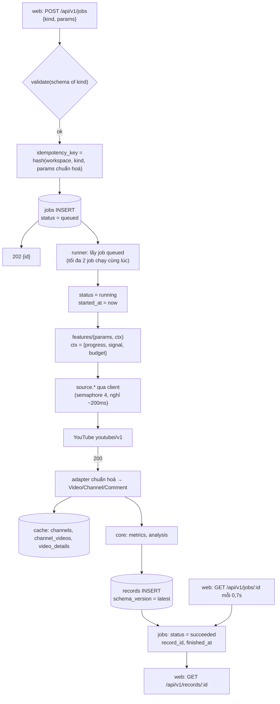
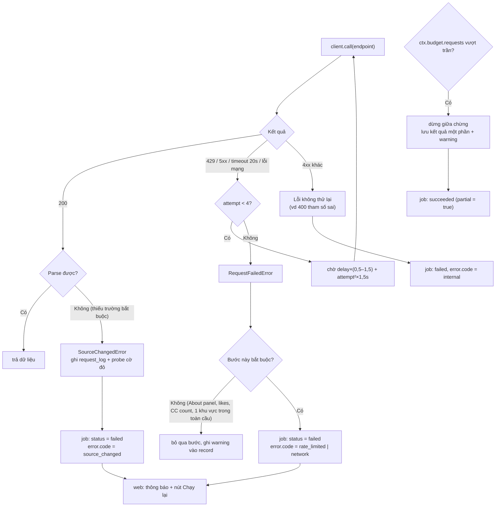
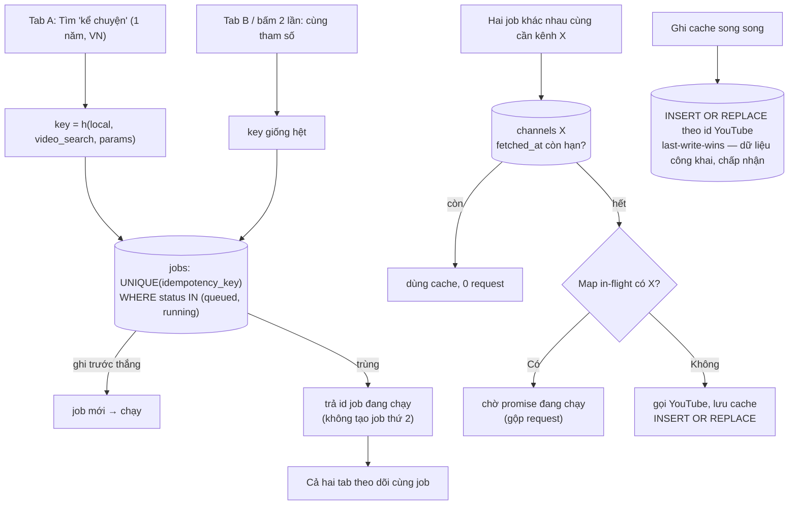
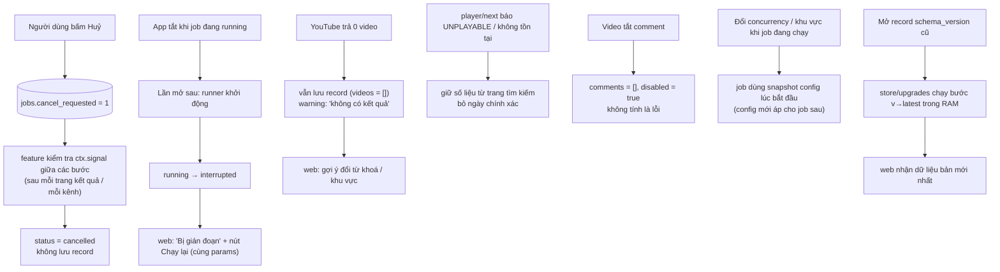

# L4 — Job nền & cào dữ liệu YouTube

Áp dụng cho mọi tác vụ cào: `video_search`, `channel_search`, `channel_analysis`, `research`, `research_comments`, `comments`, `idea_check`, `keyword_score`, `keywords`, `track_scan`.
Lý do cần L4: xử lý nền, dịch vụ ngoài có lỗi (YouTube 429/5xx/đổi định dạng), chống chạy trùng, máy trạng thái job.

Thành phần: `jobs/runner.js`, bảng `jobs`, `sources/innertube/client.js` (giới hạn đồng thời + backoff), `features/*`, bảng `records`.

---

## Flow 1 — Happy Path

---

## Flow 2 — Error & Retry

Quy ước:
- Lỗi đếm vào `request_log`; màn trạng thái hiện tỉ lệ lỗi 1 giờ gần nhất.
- 3 job liên tiếp `rate_limited` → runner tạm dừng nhận job mới 5 phút và hiện banner "YouTube đang giới hạn".
- `source_changed` không thử lại (thử lại vô ích); probe hằng ngày phát hiện sớm.

---

## Flow 3 — Idempotency & Concurrency

Ghi chú:
- Chuẩn hoá params trước khi băm: sắp xếp khoá, trim, lowercase từ khoá, bỏ trường mặc định.
- Job đã `succeeded` không chặn chạy lại (người dùng muốn số mới) — chỉ chặn trùng khi đang chạy.
- Bộ gộp request in-flight nằm trong adapter (`sources/innertube`), không ở feature.

---

## Flow 4 — Edge Cases

