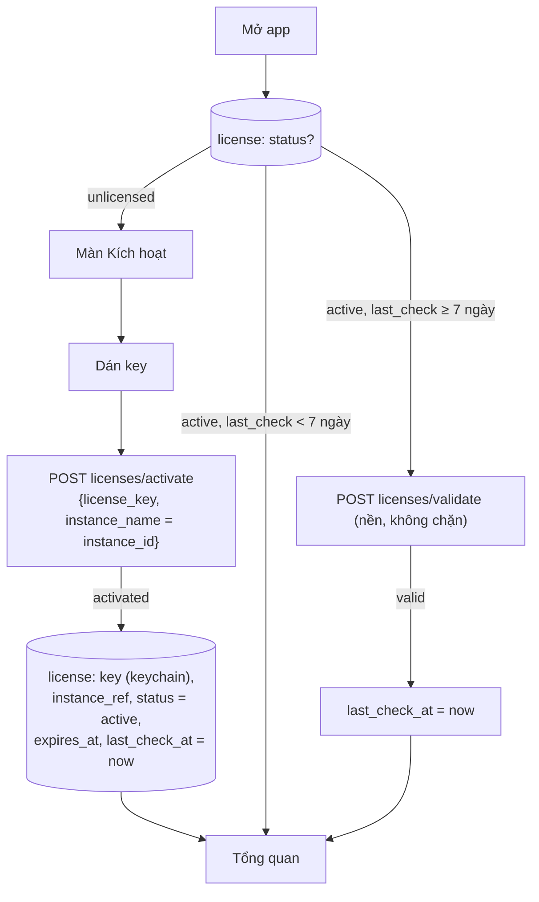
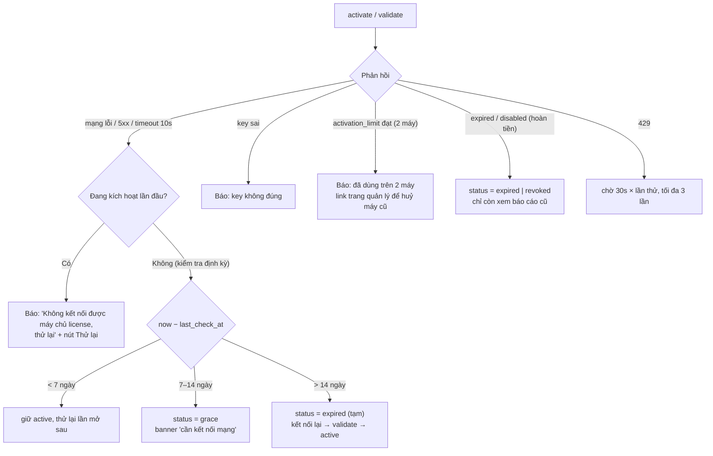
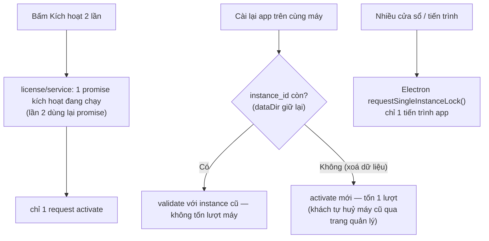
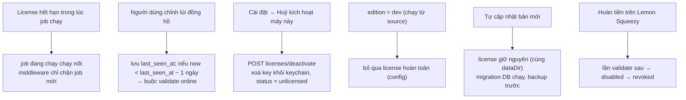

# L4 — License desktop (v1.2)

Lý do cần L4: dịch vụ ngoài có lỗi (Lemon Squeezy License API), máy trạng thái kích hoạt, giới hạn số máy (đồng thời), chạy offline.

Thành phần: `license/service.js`, `license/verify.js`, bảng `license`, middleware `requireLicense` (chỉ chặn tạo job cào mới), màn **Kích hoạt**, Lemon Squeezy `/v1/licenses/activate | validate | deactivate`.

Trạng thái: `unlicensed → active → (grace → expired) | revoked`.
- `grace`: không kiểm tra được online quá 7 ngày, còn dùng tới ngày 14.
- `expired`/`revoked`: vẫn mở và xuất báo cáo cũ; không tạo job cào mới.

Instance id = UUID tạo một lần lúc cài, lưu ở `license.instance_id`.

---

## Flow 1 — Happy Path

---

## Flow 2 — Error & Retry

---

## Flow 3 — Idempotency & Concurrency

---

## Flow 4 — Edge Cases

