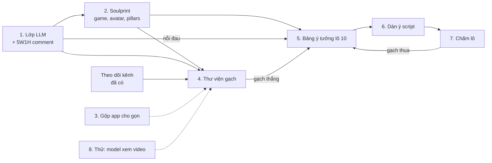

# Kế hoạch tổng: từ công cụ research thành hệ thống làm content

> Ngày: 2026-11-16 · Trạng thái: chờ duyệt
> Đây là bản đồ đường đi, không phải kế hoạch code. Mỗi giai đoạn có spec và kế hoạch triển khai riêng, viết ngay trước khi làm giai đoạn đó.

## 1. Đích đến

App hiện lấy và đo dữ liệu (video, kênh, comment). Sau kế hoạch này, app đi hết một vòng làm content theo hệ thống Kallaway, dùng kiến thức chủ app đã có (40 concept, DICK, phễu, 8 bước phân tích video viral, luật viết "có hồn"):

> Biết mình là ai và nói cho ai → tìm video đã thắng ở kênh khác → bóc thành các viên gạch → giữ gạch thắng, làm lại gạch thua → dựng dàn ý → đăng → đo theo lô 10 video.

App chỉ chạy trên máy chủ app. Không thiết kế cho bán hay nhiều người dùng.

## 2. Nguyên tắc chung cho mọi giai đoạn

1. **AI cho đầu vào, không cho đầu ra.** AI xếp nhóm, bóc tách, chấm, đề xuất. Lời văn cuối cùng do chủ app viết, hoặc viết ở Claude với skill sẵn có. App xuất Markdown cho việc đó.
2. **Số do code đếm, nhận định phải có bằng chứng.** Mỗi nhận định của AI dẫn về comment thật, mốc thời gian trong lời thoại, hoặc video đối chiếu. Thiếu bằng chứng thì ghi là giả thuyết.
3. **AI chỉ đề xuất.** Không có gì của AI vào dữ liệu của chủ app khi chưa bấm nhận.
4. **Chạy được khi chưa có API key.** Phần form, đo đếm và luật từ khoá hiện có vẫn hoạt động.
5. **Model rẻ, đổi được.** Mọi lần gọi đi qua một lớp `LlmClient` (OpenRouter). Hai ô model trong Cài đặt: gắn mã (việc nhiều) và tổng hợp (việc cần viết). Model mặc định chốt bằng chạy thử trên dữ liệu thật, luôn ghi mã phiên bản cụ thể.
6. **Kiến thức là file.** Tài liệu khoá học nằm trong `src/features/ai/knowledge/*.md`, không lên git. Chỉ phần "dạy lặp lại" của Kallaway được dùng làm luật; các ngưỡng số là ô chỉnh được.
7. **Bảy viên gạch là xương sống.** 40 concept là từ vựng cho gạch Angle, 6 archetype cho gạch Hook Structure, DICK để viết tiêu đề, 8 bước phân tích là phần đào sâu một video.
8. **Soulprint là gốc.** Mọi tính năng AI đọc hồ sơ Soulprint để biết game, avatar và pillars.
9. **Luật code giữ nguyên:** `docs/ARCHITECTURE.md`, test đi trước, không thêm thư viện, không chạy server thử trên thư mục `data` thật.

## 3. Bản đồ các giai đoạn

| # | Giai đoạn | Cần trước | Tài liệu | Cỡ |
|---|---|---|---|---|
| 1 | Lớp LLM và 5W1H comment | không | [spec](../specs/2026-11-16-comment-5w1h-design.md), [kế hoạch](2026-11-16-comment-5w1h.md) | 6 task, đã viết xong |
| 2 | Soulprint | bước form: không; bước AI: giai đoạn 1 | [spec](../specs/2026-11-16-soulprint-design.md) | khoảng 5 task |
| 3 | Gộp app cho gọn | không | chưa có spec | khoảng 4 task |
| 4 | Thư viện gạch | 1, 2 | chưa có spec | khoảng 6 task |
| 5 | Bảng ý tưởng lô 10 | 1, 2, 4 | chưa có spec | khoảng 5 task |
| 6 | Dàn ý script | 5 | chưa có spec | khoảng 4 task |
| 7 | Chấm lô | 5 | chưa có spec | khoảng 3 task |
| 8 | Thử nghiệm: model xem và nghe video | 1 | chỉ là thử nghiệm | 1 buổi |

## 4. Từng giai đoạn

### Giai đoạn 1: Lớp LLM và 5W1H comment

**Chủ app nhận được:** chọn các video đã có comment, bấm một nút, nhận báo cáo Who, What, Why, When, Where, How với số đếm thật, kèm tối đa 10 gợi ý content.

**Nền cho các giai đoạn sau:** port `LlmClient`, adapter OpenRouter, ô API key và hai ô model, thư mục kiến thức, script `llm:try` để so model.

**Xong khi:** `npm test` qua; chạy thử 5 model trên comment thật và chủ app chốt model mặc định.

Chi tiết đã có trong spec và kế hoạch riêng.

### Giai đoạn 2: Soulprint

**Chủ app nhận được:** một màn giữ hồ sơ gốc của content: kênh đang có, việc kinh doanh, game, mục tiêu 12 đến 18 tháng, avatar, kết quả mơ tới, kho nỗi đau, lợi thế riêng, điều duy nhất, câu định vị, câu lọc, 3 đến 5 pillars, giả thuyết định vị, giọng nói.

**Ba cách điền:** form; bộ 12 câu hỏi brainstorm lấy từ hai skill phỏng vấn (từng câu một, có câu đẩy khi trả lời mơ hồ, có ví dụ tốt và dở); nhập từ `BRAND.md`, `strategy.md`, `positioning.md`.

**AI (khi có key):** gọn câu trả lời, điền avatar từ câu trả lời dài, xếp hạng nỗi đau, soạn ba dạng câu định vị, kiểm tra game có khớp mục tiêu không, đọc giả thuyết định vị, xếp file tự do vào đúng mục.

**Nối với phần khác:** kho nỗi đau nhận mồi từ báo cáo 5W1H; `soulprintContext()` được đưa vào prompt của 5W1H và mọi giai đoạn sau.

**Xong khi:** điền được hồ sơ đủ dùng mà không cần API key; có key thì mọi nút AI trả đề xuất và không tự ghi; gợi ý content của 5W1H nhắc tới avatar và pillars trong hồ sơ.

### Giai đoạn 3: Gộp app cho gọn

**Vấn đề:** menu đang chia theo nền tảng, nên cùng một việc có hai màn (phân tích video TikTok và YouTube, phân tích kênh TikTok và YouTube, comment TikTok và YouTube). Thêm các màn mới vào cấu trúc này sẽ rối hơn.

**Hướng:**
- **Một màn Phân tích video.** Dán link, app tự nhận nền tảng từ link. Có ô chọn nền tảng để sửa tay khi app nhận sai. Một lần chạy chỉ một nền tảng; dán lẫn cả hai thì app tách thành hai lần chạy và nói rõ. Phía sau vẫn là hai job riêng như hiện nay.
- **Một màn Phân tích kênh**, cùng cách làm.
- **Menu theo việc, không theo nền tảng:**

| Nhóm | Màn |
|---|---|
| Gốc | Tổng quan · Soulprint |
| Tìm | Tìm theo chủ đề · Từ khoá · Theo dõi kênh |
| Mổ xẻ | Phân tích video · Phân tích kênh · Thư viện gạch (giai đoạn 4) |
| Khán giả | Thu thập bình luận · Insight · 5W1H |
| Làm | Bảng ý tưởng · Dàn ý script · Chấm lô (giai đoạn 5 đến 7) |
| Lưu trữ | Lịch sử · Đã lưu · Cài đặt |

**Không đổi:** dữ liệu đã lưu, các job, các route. Link cũ (`#/tiktok/video?id=…`) vẫn mở đúng báo cáo.

**Cần kiểm tra khi viết spec:** màn phân tích video YouTube hiện đã làm tới đâu so với spec 2026-11-13, và những màn nào khác nhau thật sự giữa hai nền tảng (cột, bộ lọc) để không gộp gượng.

**Xong khi:** mỗi việc có đúng một màn; mọi báo cáo cũ vẫn mở được; không còn mục menu nào trùng việc.

Giai đoạn này không phụ thuộc lớp LLM. Nên làm trước giai đoạn 4, để các màn mới được đặt thẳng vào menu mới.

### Giai đoạn 4: Thư viện gạch

**Chủ app nhận được:** thay cho buổi xem 25 đến 50 video thắng và ghi tay mỗi tuần. App lấy các video vượt kênh từ những kênh đang theo dõi, bóc hàng loạt mỗi video thành các viên gạch, và cho lọc, sắp xếp, so sánh.

**Mỗi video được bóc thành:**

| Gạch | Nội dung | Từ đâu |
|---|---|---|
| Topic | Chủ đề, thuộc pillar nào của Soulprint | lời thoại, tiêu đề |
| Angle | Góc tiếp cận; concept chính và phụ trong 40 concept | lời thoại |
| Niềm tin và thực tế | Điều người ta đang tin, điều video chỉ ra | lời thoại |
| Hook | Câu mở đầu nguyên văn (3 giây đầu, code cắt theo mốc thời gian); công thức hook; archetype | lời thoại có mốc thời gian |
| Story | Kiểu kể chuyện; các khối theo mốc 3 giây, 10 giây, 30 giây, kết | lời thoại có mốc thời gian |
| Visual Format, Key Visuals, Audio | Để trống, chờ giai đoạn 8 | cần model xem video |
| Phản ứng khán giả | 5 nhóm comment của skill phân tích: đồng cảm, tranh cãi, hài hước, quan tâm nhân vật, nghi ngờ | comment đã thu thập |

**Đối chiếu:** với mỗi kênh, app tự chọn video vượt kênh và video dưới trung bình, đặt gạch của chúng cạnh nhau. Gạch nào có ở video thắng mà vắng ở video thua được đánh dấu là "có thể là cốt lõi", kèm số video làm căn cứ. Đây là bước chứng minh cấp 2 và 3 của skill phân tích.

**Đào sâu một video:** nút chạy đủ 8 bước của skill phân tích (ấn tượng, hình thức, nội dung theo mốc thời gian, comment, nhận định, giả thiết, đúc kết cốt lõi và bổ trợ, công thức triển khai), xuất Markdown.

**Ngưỡng:** vượt kênh từ bao nhiêu lần thì đưa vào thư viện là một ô trong Cài đặt. Hiện là 3; Kallaway gợi ý bắt đầu từ 5.

**Xong khi:** quét một danh sách theo dõi ra được bảng gạch lọc theo pillar, concept, archetype; mỗi gạch bấm vào thấy đoạn lời thoại hoặc comment làm căn cứ.

### Giai đoạn 5: Bảng ý tưởng lô 10

**Chủ app nhận được:** một bảng làm việc theo lô 10 ý tưởng. Mỗi ý tưởng là một thẻ.

**Một thẻ gồm:** video gốc (hoặc "tự nghĩ"), gạch giữ lại, gạch làm lại, nỗi đau nhắm tới (từ Soulprint hoặc 5W1H, kèm comment), niềm tin sẽ lật, tiêu đề nháp theo DICK, giai đoạn phễu, lead magnet khớp, trạng thái (nháp, chốt, đã quay, đã đăng).

**Chấm ý tưởng theo 6 câu của Kallaway**, mỗi câu trả lời có hoặc chưa, có căn cứ:
1. Đã có video tương tự thắng dạng vượt kênh ở kênh tương đương chưa? (code tra thư viện gạch)
2. Nỗi đau nói được trong một câu chưa?
3. Góc đi ngược nói được trong một dòng chưa?
4. Khoảng cách giữa điều người ta tin và thực tế ở đâu?
5. Giữ gạch nào, làm lại gạch nào?
6. Lead magnet nào khớp?

Thêm câu lọc của Soulprint: ý tưởng này có giá trị với avatar không.

**Luật của lô:** khoảng 7 đến 8 ý tưởng từ dữ liệu vượt kênh, 2 đến 3 ý tưởng tự nghĩ; app đếm và nhắc, không chặn.

**AI:** đề xuất thẻ từ một video trong thư viện gạch ghép với một nỗi đau; trả lời nháp câu 2 đến 4. Câu 1 do code trả lời.

Giai đoạn này thay cho "lịch content" trong các bản bàn trước. Ngày đăng là một trường tuỳ chọn trên thẻ.

**Xong khi:** từ thư viện gạch và kho nỗi đau, dựng được một lô 10 thẻ, mỗi thẻ có đủ sáu câu trả lời và căn cứ.

### Giai đoạn 6: Dàn ý script

**Chủ app nhận được:** từ một thẻ đã chốt, một dàn ý để quay, không phải lời thoại hoàn chỉnh.

**Dàn ý gồm:**
- Hook 3 bước (nghiêng về, ngắt nhịp, bật ngược), 3 phương án theo các archetype hợp với hình ảnh chủ app có.
- Ba lớp hook phải nói cùng một ý: hình mở đầu, 3 đến 5 chữ trên màn hình, câu nói.
- Kiểm 4 chữ S của hook: chủ thể, được mất, đơn giản, rõ ngay.
- Khung video ngắn: Hook, Lock-In Zone, Body 1, Rehook 1, Body 2, Rehook 2, CTA; mỗi khối ghi việc phải làm và ý chính.
- Vòng lặp kể chuyện: cái đang bị đe doạ, câu hỏi lớn, cú đánh lạc hướng, chỗ mở vòng mới.
- CTA nhúng tự nhiên, dẫn về lead magnet của thẻ.

**Xuất:** Markdown theo dạng skill `content-outline` đọc được, kèm giọng nói trong Soulprint và luật "có hồn", để viết lời ở Claude.

**Kiểm bằng code, không bằng AI:** danh sách từ cấm và ký hiệu cấm của checklist "tính người" chạy trên lời chủ app dán lại vào app, trả về chỗ vi phạm.

**Xong khi:** một thẻ chốt cho ra dàn ý đủ các khối; file xuất mở được ở Claude với skill viết kịch bản.

### Giai đoạn 7: Chấm lô

**Chủ app nhận được:** sau khi đăng một lô, biết gạch nào đang thắng và gạch nào đang thua trên chính kênh mình.

**Nhập:** link video đã đăng cho từng thẻ. App tự lấy view, tim, comment. Chủ app nhập tay số khách hoặc email, và số follower tăng, vì app không thấy được các số đó.

**Xếp hạng theo game trong Soulprint:** game "trúng" xếp theo khách, rồi follower, rồi view; game "rộng" xếp theo view và tỉ lệ chia sẻ.

**Đọc kết quả:** gạch nào lặp lại ở nhóm video trên, gạch nào ở nhóm dưới, kèm số video. Dưới 10 video thì app nói rõ là chưa đủ để kết luận. Gạch thắng được gợi ý giữ cho lô sau; với video thua, app chỉ ra gạch khác biệt so với video thắng cùng chủ đề.

**Xong khi:** một lô 10 video có bảng xếp hạng và danh sách gạch thắng, gạch thua, đưa ngược về bảng ý tưởng.

### Giai đoạn 8: Thử nghiệm cho model xem và nghe video

**Câu hỏi cần trả lời:** app có tải được file video TikTok và YouTube không; một video tốn bao nhiêu token; model rẻ có nghe hiểu tiếng Việt và nhận ra nhạc, giọng, chuyển cảnh không (MiMo V2.6 Flash nhận cả hình lẫn tiếng, GLM 5.3 Flash chỉ nhận hình).

**Cách thử:** 5 video thật, code tạm, so kết quả với mô tả do chủ app tự viết. Kết quả là một bản báo cáo, không phải code giữ lại.

**Nếu được:** điền ba gạch còn trống ở giai đoạn 4 (Visual Format, Key Visuals, Audio) và Bước 2 của skill phân tích. **Nếu không:** ba gạch đó để chủ app tự điền.

Có thể chạy bất cứ lúc nào sau giai đoạn 1.

## 5. Thứ tự và lý do

1. **Giai đoạn 1** trước, vì mọi thứ dùng AI cần lớp LLM, và nó cho biết sớm model rẻ đọc tiếng Việt được tới đâu.
2. **Giai đoạn 2** kế tiếp, vì từ giai đoạn 4 trở đi tính năng nào cũng cần biết avatar, game và pillars. Ba bước đầu của nó (form, brainstorm, nhập file) không cần AI nên có thể làm song song với giai đoạn 1.
3. **Giai đoạn 3** trước khi thêm màn mới, để không phải dời màn hai lần.
4. **Giai đoạn 4** là chỗ app tạo ra nhiều giá trị nhất: Kallaway cho rằng chủ đề quyết định phần lớn kết quả, và app đã có sẵn dữ liệu vượt kênh.
5. **Giai đoạn 5, 6, 7** theo đúng dòng chảy ý tưởng, dàn ý, đo.
6. **Giai đoạn 8** là thử nghiệm, chen vào lúc nào rảnh.

## 6. Nhịp dùng hằng tuần khi đã xong

| Việc | Màn | Thời gian ước tính |
|---|---|---|
| Quét kênh theo dõi, đọc gạch của video vượt kênh mới | Theo dõi, Thư viện gạch | 30 phút |
| Thu comment của video mới, chạy 5W1H, nhận nỗi đau mới vào Soulprint | Thu thập bình luận, 5W1H, Soulprint | 15 phút |
| Dựng hoặc bổ sung lô 10 ý tưởng | Bảng ý tưởng | 30 phút |
| Dựng dàn ý cho các thẻ đã chốt, viết lời ở Claude | Dàn ý script | theo số video |
| Cuối lô: nhập số, đọc gạch thắng và thua | Chấm lô | 15 phút |

Các con số thời gian là ước tính của người viết kế hoạch, chưa đo.

## 7. Những gì cố ý không làm

- Viết bài hay lời thoại hoàn chỉnh trong app.
- Tự đăng bài, lên lịch đăng trên nền tảng.
- Tự lấy số email, khách, follower của kênh chủ app.
- So sánh chéo TikTok với YouTube trong một bảng.
- Bán app, license, nhiều người dùng.
- Dùng các ngưỡng một nguồn của Kallaway (200 view, mức kẹt 1K, 10K, 100K, tỉ lệ chia sẻ 3%) làm luật.

## 8. Rủi ro đã biết

| Rủi ro | Cách giảm |
|---|---|
| Model rẻ bóc gạch hoặc đề xuất kém bằng tiếng Việt | Chạy thử ở giai đoạn 1; mỗi bước một ô model; AI chỉ đề xuất |
| AI giải thích "vì sao viral" nghe có lý nhưng sai | Bắt dẫn bằng chứng; đối chiếu video thắng với video thua cùng kênh; ghi nhãn giả thuyết |
| Lời thoại YouTube phụ thuộc giao diện trang xem, dễ gãy | Đã có phép thử sống riêng; thư viện gạch chạy được với video thiếu lời thoại (chỉ bóc từ tiêu đề và comment, ghi rõ) |
| Phạm vi lớn, làm lâu | Mỗi giai đoạn dùng được một mình; có thể dừng sau bất kỳ giai đoạn nào |
| File kiến thức không có trong git | App chạy được khi thiếu; đường dẫn file gốc ghi trong kế hoạch giai đoạn 1 |

## 9. Việc kế tiếp

1. Chủ app duyệt kế hoạch tổng này và spec Soulprint.
2. Chạy kế hoạch giai đoạn 1 (đã viết).
3. Viết kế hoạch triển khai cho Soulprint, rồi chạy.
4. Viết spec giai đoạn 3, và cứ thế tiếp tục, mỗi lần một giai đoạn.
