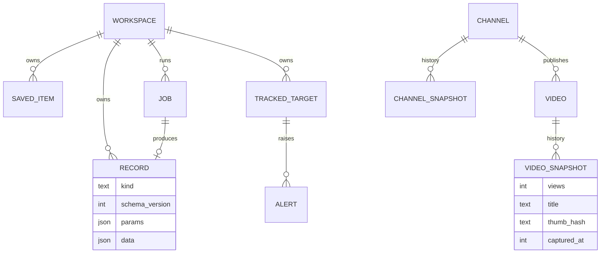
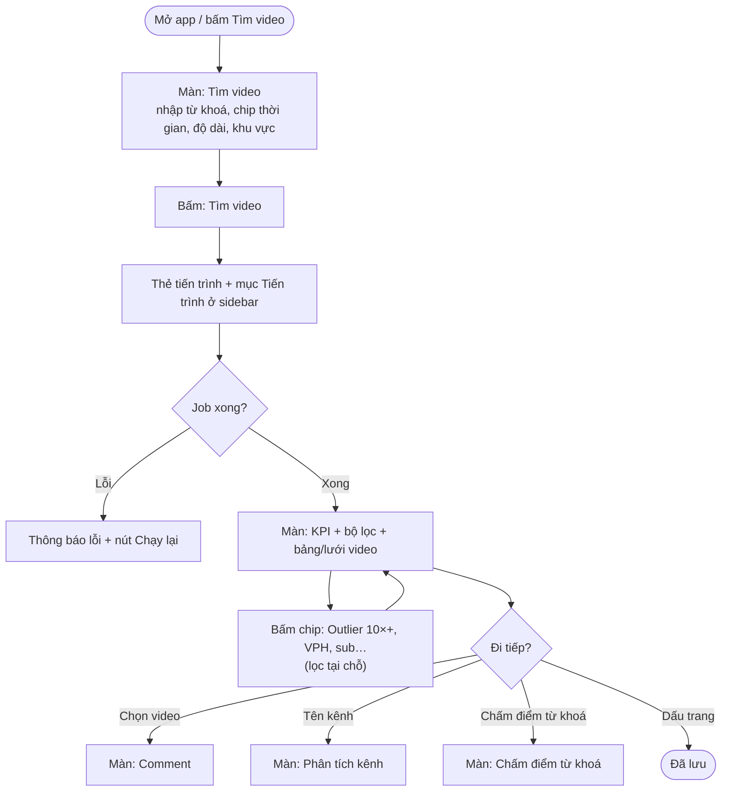
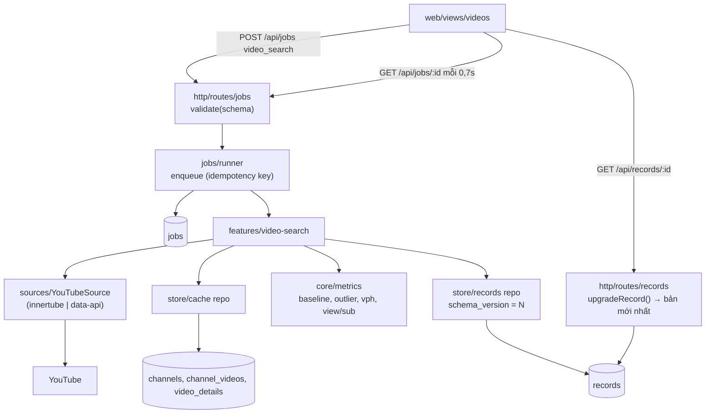
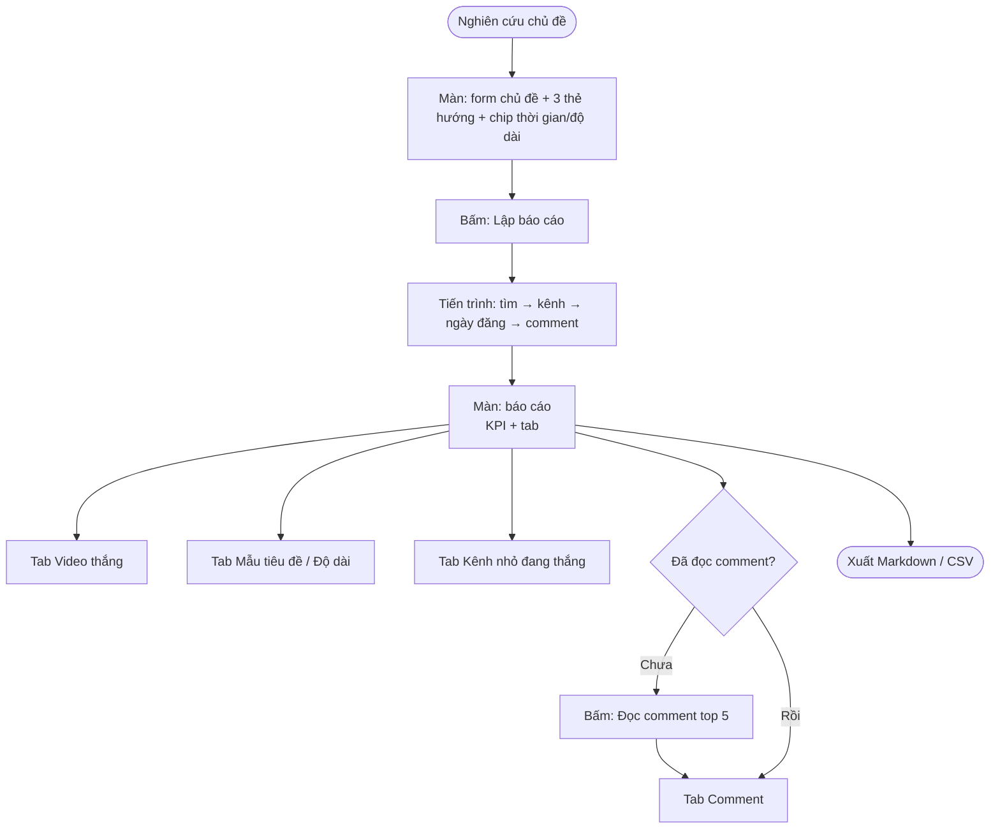
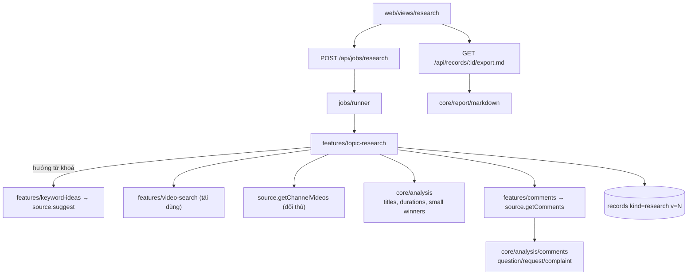
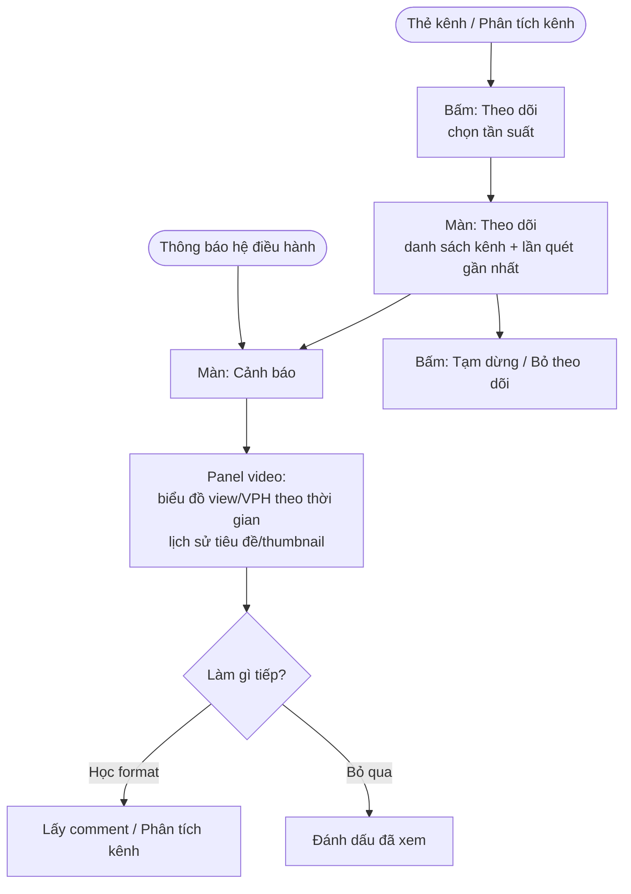
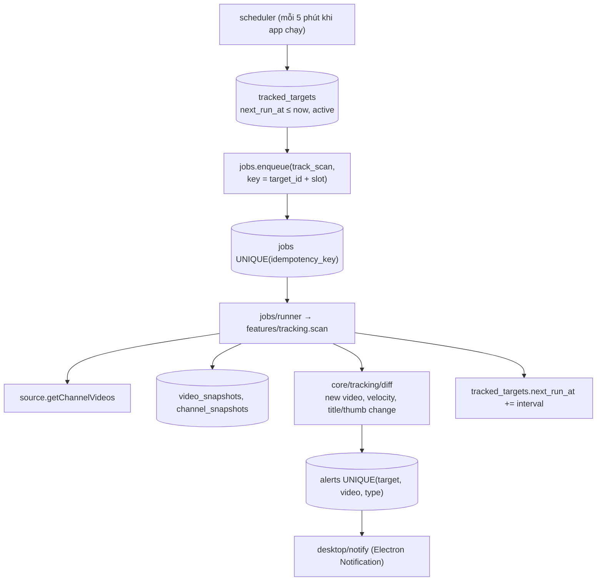
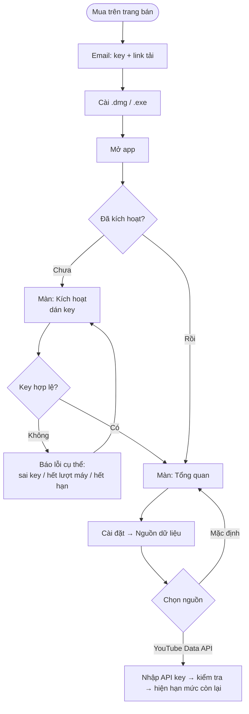
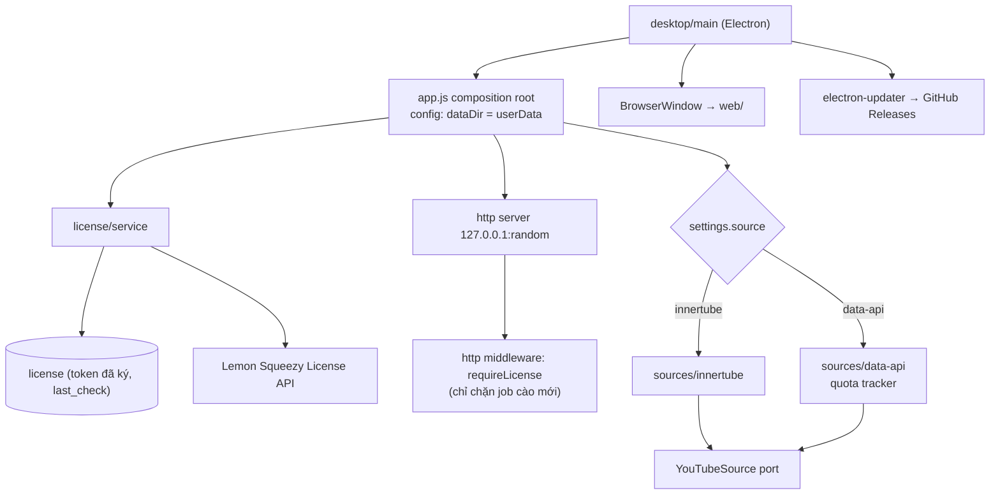

# YouTube Research — Công cụ nghiên cứu YouTube chạy trên máy, đóng gói để bán

> Phiên bản tài liệu: 1.0 · 2026-11-09 · Trạng thái: bản nháp chờ duyệt
> Tài liệu đi kèm: [ARCHITECTURE.md](ARCHITECTURE.md) (kiến trúc đích + luật chống nợ kỹ thuật) · L4: [jobs-and-scraping-L4.md](jobs-and-scraping-L4.md), [channel-tracking-L4.md](channel-tracking-L4.md), [licensing-L4.md](licensing-L4.md) · Kế hoạch: [plans/2026-11-09-architecture-refactor.md](plans/2026-11-09-architecture-refactor.md)

---

## 1. Tổng quan & mục tiêu

### Bài toán

- **Người làm kênh faceless/AI** khi chọn ngách và ý tưởng **phải mở 4–5 công cụ** (Playboard, vidIQ, 1of10, YouTube, Excel) **vì** không công cụ nào gộp đủ: lọc kênh, chấm outlier, đọc comment, chấm từ khoá trong một chỗ.
- **Họ trả $20–90/tháng mỗi công cụ** **vì** các công cụ đó tính tiền theo tính năng nghiên cứu, trong khi phần lớn dữ liệu là công khai.
- **Số liệu "lượt xem thô" đánh lừa** **vì** kênh triệu sub thì video nào cũng nhiều view; cần chỉ số so với chính kênh (outlier) và với tệp sub (view/sub).
- **Bản thân app hiện tại** (v0, ~4.400 dòng) chạy tốt cho một người, nhưng **mỗi lần thêm tính năng là vá thêm** (dữ liệu cũ thiếu trường phải vá ở giao diện, `services.js` 519 dòng gom mọi thứ, job mất khi tắt server) — không bán được ở trạng thái này.

### Mục tiêu sản phẩm

1. Trả lời "video nào thắng nhờ nội dung, tiêu đề mẫu nào, khán giả hỏi gì, khoảng trống ở đâu" cho một chủ đề **trong dưới 2 phút, $0 chi phí dữ liệu**.
2. **Tự theo dõi** kênh đối thủ và từ khoá, báo video viral (≥ 5× kênh) **trong vòng 6 giờ** kể từ lúc app phát hiện.
3. **Đóng gói desktop có license**: khách mua → cài → kích hoạt **dưới 3 phút**, không cần dòng lệnh.
4. **Thêm một tính năng mới không phải sửa code cũ ngoài 3 nơi**: use case mới, route mới, view mới (đo bằng diff của từng PR tính năng).
5. **Phát hiện YouTube đổi định dạng trong 24 giờ** (probe tự chạy) và sửa chỉ trong lớp adapter.

### Người dùng

| Persona | Mô tả | Bối cảnh dùng |
|---|---|---|
| **Chủ sản phẩm (Chris)** | Làm nhiều kênh, nghiên cứu ngách hằng tuần, biết kỹ thuật | Mac, mở app nhiều lần/tuần, dùng cả CLI + skill Claude Code |
| **Khách mua desktop** | Người làm YouTube faceless VN/US, không biết dòng lệnh, 20–40 tuổi | Mac/Windows, phiên 15–60 phút, 2–5 lần/tuần |
| **Team (sau, SaaS)** | 2–10 người dùng chung workspace | Trình duyệt, chia sẻ báo cáo và danh sách kênh |

Động lực chính: tìm ngách và ý tưởng có xác suất thắng cao trước khi tốn công sản xuất (quy trình Thanh Hải bước 1–3, 7).

### Phạm vi

**Trong phạm vi (v1.0 → v1.2):**
- Mọi tính năng đang có: tìm video (outlier, view/sub, VPH, toàn cầu), tìm kênh kiểu Playboard, nghiên cứu chủ đề, phân tích/so sánh kênh, comment, chấm điểm từ khoá, gợi ý từ khoá, đã lưu, CLI, skill.
- **Tái cấu trúc** theo [ARCHITECTURE.md](ARCHITECTURE.md) (giai đoạn 0, không đổi hành vi).
- **Theo dõi kênh/từ khoá tự động** + lịch sử view → VPH theo thời gian thật, phát hiện đổi tiêu đề/thumbnail.
- **Desktop app** (Electron) + license key + tự cập nhật.
- **Nguồn dữ liệu thay thế được**: InnerTube (mặc định) và YouTube Data API v3 chính thức (khách tự nhập key).

**Ngoài phạm vi:**
- SaaS nhiều người dùng trên VPS — làm ở v2 sau khi có khách desktop trả tiền; kiến trúc chừa sẵn (workspace_id, port cho store/jobs) nhưng không triển khai.
- Chrome extension — chưa chọn; có thể dùng chính server local làm API sau.
- AI phân tích trong app — chưa chọn; giữ ô API key và luồng "Markdown → Claude".
- Tìm thumbnail giống nhau, xếp hạng so với video cùng thời điểm — cần chỉ mục hàng triệu video, không hợp app chạy trên máy.
- Transcript/phụ đề — YouTube yêu cầu token khi không đăng nhập; không lách.

### Chỉ số thành công

| Chỉ số | Mục tiêu | Cách đo |
|---|---|---|
| Thời gian lập báo cáo chủ đề (2 từ khoá + comment top 5) | < 90 giây | `jobs.finished_at − started_at` |
| Tỉ lệ request YouTube lỗi | < 2% / tuần | bảng `request_log` (đếm theo mã lỗi) |
| Thời gian phát hiện YouTube đổi định dạng | < 24 giờ | probe hằng ngày ghi `probe_runs` |
| Số chỗ vá dữ liệu cũ ở giao diện | 0 | grep "fallback"/"older records" trong `web/` |
| Độ phủ test lớp `core/` | ≥ 80% dòng | `node --test --experimental-test-coverage` |
| Kích hoạt license thành công lần đầu | ≥ 95% | log kích hoạt (ẩn danh) |
| Khách desktop trả tiền 3 tháng đầu | 50 | dashboard Lemon Squeezy |

---

## 2. User stories

### Story 1: Tìm video outlier cho một chủ đề
- **Vai trò**: Người làm kênh
- **Mục tiêu**: Thấy video thắng vì nội dung để học format
- **Luồng**:
  1. Mở **Tìm video**, nhập "kể chuyện lịch sử việt nam", chọn 1 năm, 4–20 phút, Việt Nam.
  2. App tìm 60 video, lấy sub + 30 video gần nhất của mỗi kênh, tính outlier, VPH, view/sub; thanh tiến trình cập nhật mỗi giây.
  3. Bấm chip **Outlier 10×+** → danh sách lọc ngay, không tìm lại.
  4. Chọn 5 video → **Lấy comment**.
- **Tiêu chí chấp nhận**:
  - 60 video có kết quả trong ≤ 20 giây (kênh đã cache ≤ 8 giây).
  - Mỗi video có `outlierScore` hoặc lý do không có (Shorts / kênh < 3 video đủ tuổi) hiện ở tooltip.
  - Mở lại lần tìm cũ (tạo bởi phiên bản app cũ hơn) hiển thị đủ cột, không có "–" do thiếu trường.

### Story 2: Lập báo cáo nghiên cứu chủ đề
- **Vai trò**: Người làm kênh / skill `nghien-cuu-youtube`
- **Mục tiêu**: Trả lời 4 câu hỏi về chủ đề
- **Luồng**:
  1. **Nghiên cứu chủ đề** → nhập chủ đề, chọn hướng (top/trend/từ khoá), bật đọc comment top 5.
  2. App chạy job nền (tìm → enrich → xếp hạng → comment → phân tích tiêu đề/comment) và lưu báo cáo.
  3. Xem tab Video thắng / Mẫu tiêu đề / Độ dài / Kênh nhỏ / Comment; xuất Markdown cho Claude.
- **Tiêu chí chấp nhận**:
  - Đóng tab trình duyệt giữa chừng không làm mất job; mở lại thấy tiến trình.
  - Tắt app giữa chừng → mở lại job hiện "bị gián đoạn", có nút chạy lại.
  - Markdown digest ≤ 60 KB, không chứa tên người bình luận.

### Story 3: Theo dõi kênh đối thủ (mới)
- **Vai trò**: Người làm kênh
- **Mục tiêu**: Biết ngay khi đối thủ ra video viral hoặc đổi tiêu đề/thumbnail
- **Luồng**:
  1. Ở thẻ kênh bấm **Theo dõi**; chọn tần suất (6 giờ mặc định).
  2. App quét định kỳ khi đang mở (desktop chạy nền ở khay hệ thống), lưu snapshot view từng video.
  3. Video mới đạt ≥ 5× trung vị kênh → thông báo hệ điều hành + mục **Cảnh báo**.
  4. Mở video → biểu đồ view/VPH theo thời gian, lịch sử tiêu đề/thumbnail.
- **Tiêu chí chấp nhận**:
  - Không tạo hai lần quét trùng cho cùng kênh trong cùng khung giờ.
  - Không báo trùng một video viral hai lần.
  - 50 kênh theo dõi × 4 lần/ngày ≤ 400 request/ngày.

### Story 4: Chấm điểm từ khoá / ý tưởng
- **Vai trò**: Người làm kênh
- **Mục tiêu**: Biết từ khoá có cửa không trước khi làm
- **Luồng**: nhập nhiều từ khoá → thẻ điểm kiểu vidIQ (tổng, Volume ước tính, Competition, tình trạng, thống kê top 20, top kênh, từ khoá liên quan chấm khi bấm).
- **Tiêu chí chấp nhận**: ≤ 6 giây/từ khoá; mọi điểm có tooltip giải thích công thức; nhãn "ước tính" luôn hiện cạnh Volume.

### Story 5: Mua và kích hoạt bản desktop (mới)
- **Vai trò**: Khách mua
- **Mục tiêu**: Dùng được app trong vài phút
- **Luồng**:
  1. Mua trên trang bán (Lemon Squeezy) → nhận email có license key + link tải.
  2. Cài (.dmg / .exe), mở app → màn **Kích hoạt** → dán key.
  3. App xác thực online, lưu token kích hoạt, mở **Tổng quan**.
- **Tiêu chí chấp nhận**:
  - Kích hoạt ≤ 10 giây; mất mạng sau khi kích hoạt vẫn dùng được ≥ 14 ngày.
  - Key dùng tối đa 2 máy; máy thứ 3 báo rõ cách huỷ máy cũ.
  - Hết hạn/hoàn tiền → app vẫn mở được báo cáo đã lưu (chỉ khoá tác vụ cào mới).

---

## 3. Yêu cầu chức năng

### Bảng tính năng

| Tính năng | Mô tả | Ưu tiên | Phụ thuộc |
|---|---|---|---|
| Tái cấu trúc giai đoạn 0 | Tách lớp, migration, record có phiên bản, job lưu DB, registry chỉ số | Must | — |
| Tìm video + outlier | Đã có; chuyển sang use case + adapter | Must | Giai đoạn 0 |
| Tìm kênh kiểu Playboard | Đã có | Must | Giai đoạn 0 |
| Nghiên cứu chủ đề + comment | Đã có | Must | Giai đoạn 0 |
| Phân tích / so sánh kênh | Đã có | Must | Giai đoạn 0 |
| Chấm điểm từ khoá | Đã có | Must | Giai đoạn 0 |
| Theo dõi kênh + lịch sử view | Quét định kỳ, snapshot, cảnh báo viral, đổi tiêu đề/thumbnail | Must (v1.1) | Job lưu DB, scheduler |
| Desktop app (Electron) | Gói server + giao diện, khay hệ thống, tự cập nhật | Must (v1.2) | Giai đoạn 0, config đường dẫn |
| License key | Kích hoạt, kiểm tra định kỳ, giới hạn máy | Must (v1.2) | Desktop |
| Nguồn YouTube Data API | Adapter thứ hai, khách tự nhập key, hiện hạn mức | Should (v1.2) | Port `YouTubeSource` |
| Giao diện tiếng Anh | i18n chuỗi giao diện | Should (v1.2) | Frontend mới |
| Frontend Preact + Vite | Viết lại giao diện theo component | Should (v1.2) | API ổn định có schema |
| SaaS (Postgres, auth, Stripe, queue) | Nhiều người dùng | Nice (v2) | workspace_id, port store/jobs |

### Kiến trúc thông tin

**Màn hình**: Tổng quan · Tìm video · Tìm kênh · Nghiên cứu chủ đề · Từ khoá người xem gõ · Phân tích kênh · So sánh kênh · Comment · Chấm điểm từ khoá · **Theo dõi** (mới) · **Cảnh báo** (mới) · Đã lưu · Cài đặt · **Kích hoạt** (desktop).

**Thực thể dữ liệu chính** (chi tiết ở ARCHITECTURE.md §5):

---

## 4. Luồng kiến trúc

### 4.1 Tìm video + Outlier

#### L0 — Ý định & kết quả
**Ý định**
- Tránh bị đánh lừa bởi view thô của kênh to.
- Thấy ngay video vượt mức bình thường của chính kênh nó.

**Kết quả**
- Danh sách video có Outlier (× kênh), View/sub, VPH; lọc tức thì; dùng làm đầu vào cho comment, phân tích kênh, chấm điểm.

#### L1 — Luồng nghiệp vụ
1. Người dùng nhập từ khoá + bộ lọc (thời gian, độ dài, khu vực/toàn cầu).
2. App tìm video trên YouTube theo từng khu vực, gộp và bỏ trùng.
3. App lấy thông tin kênh và 30 video gần nhất của từng kênh (dùng bộ nhớ đệm).
4. App tính mốc "view thường lệ" của từng kênh rồi tính Outlier, View/sub, VPH.
5. App lưu kết quả thành một lần tìm; người dùng lọc, sắp xếp, chọn video để đi tiếp.

#### L2 — Luồng người dùng

#### L3 — Luồng hệ thống

### 4.2 Nghiên cứu chủ đề + Comment

#### L0
**Ý định**: Không phải tự đọc hàng trăm video và comment. **Kết quả**: Báo cáo 4 câu hỏi + Markdown cho Claude/AI, lập dưới 90 giây.

#### L1
1. Người dùng nhập chủ đề, từ khoá, hướng, đối thủ.
2. App (hướng "từ khoá") lấy gợi ý tìm kiếm để mở rộng từ khoá.
3. App chạy luồng 4.1 cho mọi từ khoá, thêm video của kênh đối thủ.
4. App xếp hạng (view/sub, outlier, view/ngày), phân tích mẫu tiêu đề, độ dài, kênh nhỏ đang thắng.
5. App (nếu bật) đọc comment top 5 video, phân loại câu hỏi / yêu cầu / phàn nàn.
6. App lưu báo cáo; người dùng xem tab hoặc xuất Markdown/CSV.

#### L2

#### L3

### 4.3 Theo dõi kênh tự động (mới — v1.1)

#### L0
**Ý định**: Không phải ngày nào cũng mở từng kênh đối thủ để xem có gì mới. **Kết quả**: Thông báo trong vài giờ khi đối thủ ra video viral hoặc đổi tiêu đề/thumbnail; có VPH theo thời gian thật cho mọi video đang theo dõi.

#### L1
1. Người dùng bấm **Theo dõi** ở kênh (hoặc từ khoá).
2. Bộ lập lịch tạo lần quét theo tần suất; chỉ một lần quét cho mỗi kênh trong mỗi khung giờ.
3. Lần quét lấy 30 video mới nhất, ghi snapshot view, tiêu đề, thumbnail.
4. App so với snapshot trước: video mới, tốc độ tăng view, đổi tiêu đề/thumbnail.
5. Video mới đạt ngưỡng (≥ 5× trung vị kênh, hoặc VPH ≥ 5× VPH thường) → tạo cảnh báo (một lần mỗi video).
6. Người dùng xem cảnh báo, mở biểu đồ VPH theo thời gian.

#### L2

#### L3

L4: [channel-tracking-L4.md](channel-tracking-L4.md).

### 4.4 Desktop + license + nguồn dữ liệu (mới — v1.2)

#### L0
**Ý định**: Khách không biết dòng lệnh vẫn cài và dùng được; chủ sản phẩm thu tiền mà không phải vận hành server cào dữ liệu. **Kết quả**: Cài trong 3 phút, kích hoạt bằng key, dữ liệu cào bằng IP của từng khách; khách nào lo rủi ro điều khoản YouTube thì chuyển sang API chính thức bằng key của họ.

#### L1
1. Khách mua trên Lemon Squeezy → nhận key + link tải.
2. Khách cài, mở app → app khởi động server nội bộ ở cổng ngẫu nhiên, mở cửa sổ.
3. Chưa kích hoạt → màn Kích hoạt; nhập key → app gọi API license → lưu token đã ký.
4. App kiểm tra lại license định kỳ (7 ngày); offline tối đa 14 ngày.
5. Trong Cài đặt, khách chọn nguồn dữ liệu: "Mặc định (không cần key)" hoặc "YouTube Data API (key của bạn)".
6. App tự kiểm tra bản cập nhật, tải và cài khi khởi động lại.

#### L2

#### L3

L4: [licensing-L4.md](licensing-L4.md). Job nền và cào dữ liệu dùng chung: [jobs-and-scraping-L4.md](jobs-and-scraping-L4.md).

---

## 5. Yêu cầu phi chức năng

| Yêu cầu | Mục tiêu |
|---|---|
| Hiệu năng | Tìm 60 video ≤ 20 giây (lạnh), ≤ 8 giây (đã cache); giao diện phản hồi lọc ≤ 100 ms với 500 video |
| Tôn trọng nguồn | Mặc định 4 request song song, nghỉ 200 ms, backoff khi 429; ngân sách request mỗi job; không bao giờ lách CAPTCHA/token |
| Bảo mật | Server chỉ nghe `127.0.0.1`; không lưu tên người bình luận vào báo cáo; API key lưu trong keychain hệ điều hành (desktop) |
| Bền dữ liệu | SQLite WAL; migration đánh số; backup tự động trước mỗi migration; record có `schema_version` |
| Khả năng mở rộng | Port cho `store` (SQLite → Postgres), `jobs` (in-process → pg-boss), `source` (innertube → data-api); `workspace_id` ở mọi bảng thuộc người dùng |
| Nền tảng | macOS 13+ (arm64, x64), Windows 10+; trình duyệt Chromium (Electron) |
| Ngôn ngữ | Giao diện tiếng Việt (v1.0–1.1), thêm tiếng Anh (v1.2); chuỗi giao diện tách file |
| Quan sát | Log có cấu trúc (JSON lines) ở `dataDir/logs`; màn trạng thái hiển thị tỉ lệ lỗi request |

---

## 6. Cân nhắc kỹ thuật

- **Stack**: Node ≥ 22 (`node:sqlite`, `fetch`), JavaScript + JSDoc + `tsc --noEmit --checkJs` (không bước build cho backend). Frontend v1.0–1.1: JS thuần tách module; v1.2: Preact + Vite (build ra `web/dist`). Desktop: Electron + electron-builder + electron-updater. License: Lemon Squeezy License API.
- **Nguồn dữ liệu**: InnerTube (`youtubei/v1`: search, browse, player, next) + suggest; tương lai YouTube Data API v3 (search.list 100 đơn vị/lần, videos.list/channels.list 1 đơn vị).
- **Lưu trữ**: SQLite một file trong `dataDir` (`~/Library/Application Support/YouTube Research` khi đóng gói; `./data` khi dev).
- **Kiến trúc**: ports & adapters (hexagonal) — chi tiết và luật ở [ARCHITECTURE.md](ARCHITECTURE.md).
- **AI** (chưa làm): port `Analyzer` nhận digest Markdown; adapter Claude API sẽ thêm khi chọn.

---

## 8. Rủi ro & giảm thiểu

| Rủi ro | Tác động | Khả năng | Giảm thiểu |
|---|---|---|---|
| YouTube đổi định dạng API nội bộ | Cao | Cao | Parser chỉ nằm trong `sources/innertube`; test bằng fixture ghi sẵn; probe hằng ngày; adapter Data API làm đường lui |
| Vi phạm điều khoản YouTube khi bán bản cào dữ liệu | Cao | Trung bình | Desktop: mỗi khách cào bằng IP của mình, lượng nhỏ; có tuỳ chọn API chính thức; điều khoản bán hàng nói rõ trách nhiệm người dùng; hỏi luật sư trước khi bán (Open Questions) |
| Bị chặn tạm (429) khi quét nhiều | Trung bình | Trung bình | Ngân sách request mỗi job, backoff, giới hạn số kênh theo dõi, giãn lịch quét |
| Nợ kỹ thuật quay lại khi thêm tính năng | Trung bình | Cao | Luật phụ thuộc kiểm bằng test; record có phiên bản; registry chỉ số; checklist PR trong ARCHITECTURE.md |
| Crack license desktop | Thấp | Trung bình | Token ký bằng khoá công khai, kiểm tra online định kỳ; chấp nhận rủi ro (khách mục tiêu nhỏ) |
| Viết lại frontend kéo dài | Trung bình | Trung bình | Làm sau khi API có schema; chuyển từng màn, giữ màn cũ chạy song song |

## 9. Lộ trình

| Giai đoạn | Phạm vi | Thời lượng | Mốc |
|---|---|---|---|
| 0 — Tái cấu trúc | Tách lớp, migration, record versioning, job lưu DB, registry chỉ số, fixture test, typecheck | 1–1,5 tuần | 2026-11-20 |
| 1.1 — Theo dõi | Tracked targets, scheduler, snapshot, cảnh báo, VPH theo thời gian, đổi tiêu đề/thumbnail | 1,5 tuần | 2026-12-04 |
| 1.2 — Đóng gói bán | Electron, license, auto-update, nguồn Data API, frontend Preact, tiếng Anh, trang bán | 3 tuần | 2026-12-25 |
| 2 — SaaS | Postgres, auth, workspace, pg-boss, Stripe, proxy/Data API | 4–6 tuần | sau khi có 50 khách desktop |

---

## 10. Câu hỏi mở

- [ ] **Pháp lý**: bán bản dùng API nội bộ của YouTube có chấp nhận được không? Cần hỏi luật sư / đọc kỹ YouTube ToS §4–5 trước v1.2. Nếu không → bản bán chỉ dùng Data API (khách tự có key).
- [ ] **Giá**: một lần ($49–99, cập nhật 1 năm) hay thuê bao ($9–15/tháng)? Ảnh hưởng thiết kế license (hết hạn hay không).
- [ ] **Thị trường đầu tiên**: khách Việt (giao diện VN, thanh toán nội địa?) hay quốc tế (tiếng Anh trước)?
- [ ] **Windows**: có bán cho Windows ngay v1.2 không? (cần máy test + ký code ~$100–300/năm)
- [ ] **Theo dõi khi tắt app**: chấp nhận chỉ quét khi app mở/chạy ở khay, hay cần dịch vụ nền của hệ điều hành?
- [ ] **Skill/CLI** có nằm trong bản bán không, hay chỉ cho bản cá nhân?
